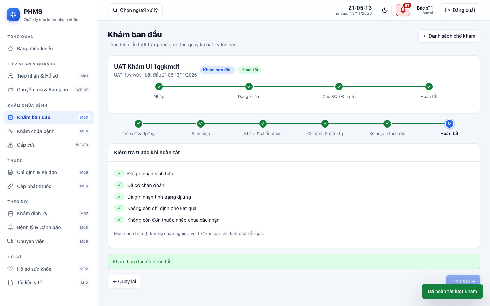
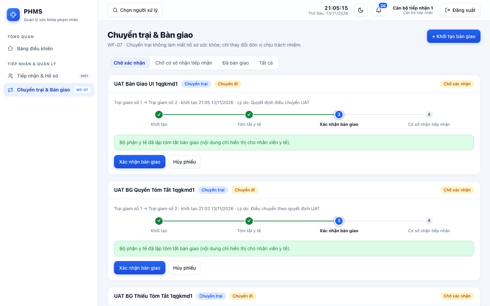
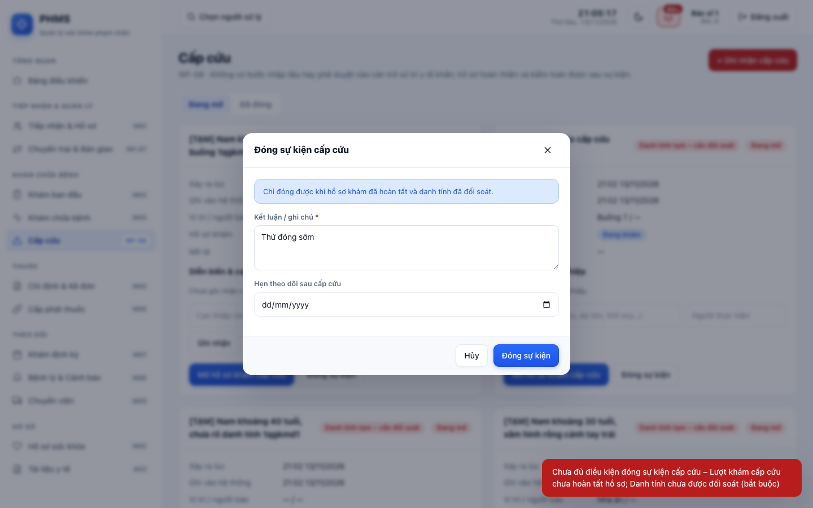
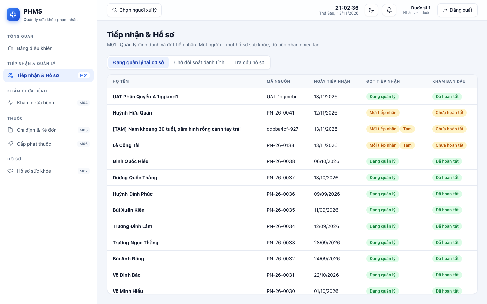
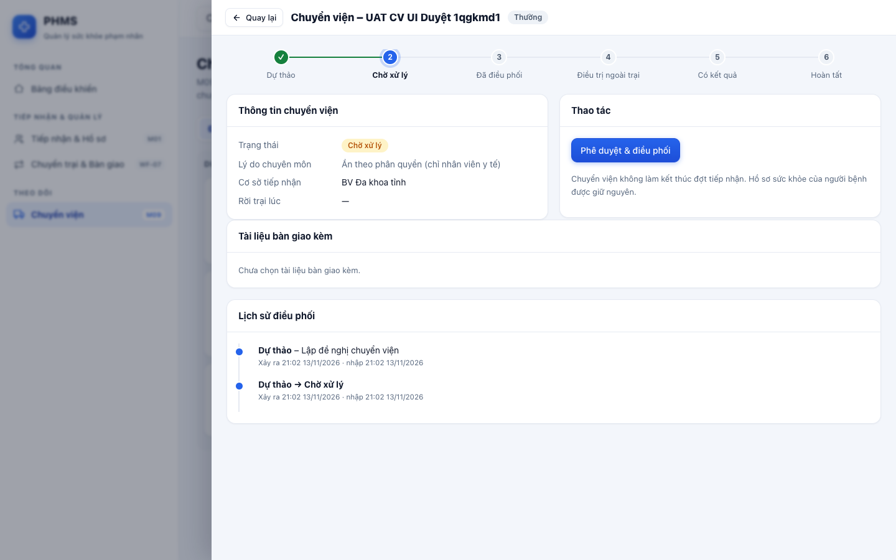
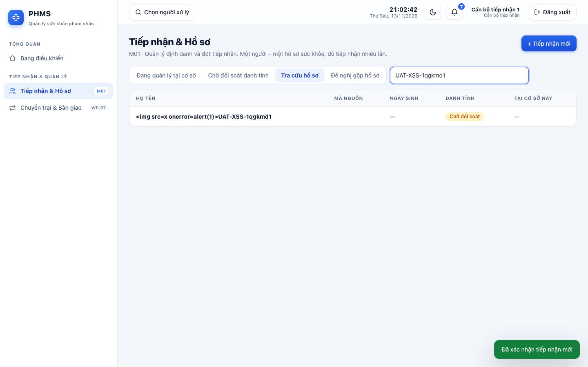

# Báo cáo UAT – PHMS (Prisoner Health Management System) – Gói Core MVP

| | |
|---|---|
| Ngày thực hiện | 13/11/2026 |
| Đối tượng | Mã nguồn tại `/Users/linhpham/Documents/phms` (backend FastAPI + frontend React). Thư mục không có git nên **không có số phiên bản/commit** để ghi vào báo cáo |
| Môi trường | **Staging riêng**: máy chủ `localhost:8765`, CSDL SQLite + kho tài liệu mã hóa nằm trong thư mục tạm, `PHMS_ENV=dev`, dữ liệu **giả lập** (seed + demo 46 hồ sơ + dữ liệu do bộ test sinh ra) |
| Dữ liệu thật | **Không đụng tới.** `backend/phms.db` và máy chủ cổng 8000 của dự án giữ nguyên: dấu vân tay MD5 của `phms.db` trước/sau phiên UAT trùng nhau (`b652e8ad645a4e062537a8f0caaf0c63`) |
| Mã nguồn | **Không sửa** trong suốt UAT (chỉ đọc để phân tích) |
| Người thực hiện | AI – đóng vai Senior BA + Senior UAT Tester (Claude) |
| Trạng thái văn bản | **Báo cáo của người kiểm thử – CHƯA phải kết luận chấp nhận UAT.** Quyết định *UAT Accepted / Go-Live* thuộc người dùng có thẩm quyền của khách hàng |

---
## 1. Tóm tắt điều hành

| Chỉ số | Kết quả |
|---|---|
| Tổng số UAT test case | **156** (Positive / Negative / Boundary / Permission / Cross-dept / Concurrency / Security / Data-consistency…) |
| ✅ PASS | **143** (91.7%) |
| ❌ FAIL | **11** – quy về **4 lỗi (DEF-01…04) + 2 điểm cần xác nhận yêu cầu (REQ-01, REQ-02)** |
| ⛔ BLOCKED | **2** (chưa kiểm được trên staging – xem mục 5.4) |
| Lỗi theo mức độ | 🔴 Critical **1** · 🟠 High **1** · 🟡 Medium **2** · 🔵 Low **0** (+ 2 điểm *cần BA xác nhận*: Medium, Low) |

**Khuyến nghị của người kiểm thử: ⛔ NO-GO cho Go-Live với dữ liệu thật ở thời điểm này**, vì còn **1 lỗi Critical về phân quyền/toàn vẹn hồ sơ y tế** và **1 lỗi High về toàn vẹn nghiệp vụ**. Phần còn lại của hệ thống đáp ứng rất tốt (xem mục 6). Hai lỗi nghiêm trọng đều khoanh vùng được, sửa nhỏ, và có bài kiểm tra tái hiện sẵn để kiểm lại.

**Năm điều cần biết nhanh**
1. 🔴 **DEF-01 – Truy cập khẩn (break-glass) “chỉ đọc” nhưng vẫn *ghi* được vào Tài liệu y tế**: người ngoài cơ sở chỉ cần nhập lý do ≥10 ký tự là có thể *tải lên*, *thay thế* và *vô hiệu hóa* tài liệu y tế trong hồ sơ người bệnh của cơ sở khác. Các thao tác ghi lâm sàng khác (sinh hiệu, chẩn đoán, đơn thuốc, dị ứng…) đều bị chặn đúng.
2. 🟠 **DEF-02 – Gửi đồng thời tạo được *nhiều* lượt “khám ban đầu” cho một đợt tiếp nhận** (tái hiện 8/10 lần; có lần ra 6 lượt) – vi phạm quy tắc “một khám ban đầu cho mỗi đợt”.
3. 🟡 **DEF-03 – Một số thao tác thiếu khóa chống tranh chấp** (xác nhận/điều chỉnh đơn thuốc, duyệt chuyển viện, nhận cảnh báo): bản ghi nhật ký/sự kiện/bản nháp bị nhân đôi khi hai người cùng bấm.
4. 🟡 **DEF-04 – Lập được đề nghị chuyển viện trên lượt khám đã *hủy*** → chuyển viện “mồ côi” đang mở.
5. ✅ Các điểm “ăn tiền” của thiết kế đều đạt: *một người – một hồ sơ*; cách ly Trại 1/Trại 2; bất biến dữ liệu (addendum/phiên bản); *kê đơn ≠ cấp phát ≠ sử dụng*; tách quyết định chuyên môn – hành chính; chuỗi nhật ký kiểm toán phát hiện can thiệp; tài liệu lưu **mã hóa**; không có API xóa.

---
## 2. Phạm vi, phương pháp và giới hạn

### 2.1 Cách thực hiện theo 5 phase
| Phase | Việc đã làm |
|---|---|
| 1. Phân tích hệ thống | Đọc tài liệu `docs/01–07`, `permissions.py`, toàn bộ `modules/*.py` (111 endpoint), mô hình dữ liệu, giao diện React; lập sơ đồ quy trình, ma trận vai trò, và **rà soát có hệ thống các endpoint *ghi* để tìm chỗ thiếu bảo vệ ABAC** (đã dẫn tới DEF-01) |
| 2. Thiết kế UAT | 156 test case, mỗi ca có *kết quả mong đợi* lấy từ yêu cầu (BR-01…07, WF-01…09, UAT-01…12, mục 04 §2) – **không lấy từ hành vi quan sát của hệ thống** |
| 3. Thực thi | Playwright (Chromium) thao tác giao diện như người dùng thật theo từng vai trò (đăng nhập, menu, wizard khám ban đầu 6 bước, tiếp nhận 3 bước, bàn giao liên cơ sở, cấp cứu, cấp phát, báo cáo, quản trị) **+ gọi API trực tiếp** cho ca âm tính/biên/đồng thời **+ đối chiếu CSDL** bằng SQL chỉ-đọc. Ảnh chụp và nhật ký API/SQL của *từng ca* được lưu |
| 4. Đối chiếu | Mỗi FAIL được xác minh lại thủ công để phân biệt *lỗi hệ thống* – *lỗi kịch bản test* – *yêu cầu chưa xác nhận* |
| 5. Báo cáo | Tài liệu này |

### 2.2 Nguồn yêu cầu & nguyên tắc “không suy diễn”
- Tài liệu thiết kế gốc *“PHMS – Phân tích nghiệp vụ & thiết kế giải pháp v1.0 (11/11/2026)”* **không có trong thư mục dự án**. Kết quả mong đợi dựa vào các tài liệu truy vết của dự án: `docs/01` (BR/WF/quyết định thiết kế D1–D10), `docs/04` (ma trận vai trò & kịch bản mong đợi), `docs/06`.
- Chỗ tài liệu **không nói rõ**, ca test được gắn nhãn **“cần xác nhận yêu cầu”** thay vì tự kết luận là lỗi (REQ-01, REQ-02 và EXP-06/07/22 – xem 5.3).
- Hành vi cố ý đã được tài liệu ghi (mục 04 §6: tài khoản mẫu giữ nguyên, gộp hồ sơ không tự động, SSO chưa thử IdP thật…) **không** bị báo là lỗi.

### 2.3 Lịch sử các lần chạy (minh bạch)
| Lần | Kết quả | Ghi chú |
|---|---|---|
| 1 (122 ca) | 111 đạt / 9 FAIL / 2 BLOCKED | Trong 9 FAIL: **8 là lỗi kịch bản của người kiểm thử** (sai mã HTTP 200 vs 201, thiếu trường bắt buộc `note`, chưa xác nhận bản v2 trước khi kiểm bản cũ, selector giao diện, đếm nhầm ký tự lý do break-glass…) và 1 hành vi **đúng thiết kế** (cán bộ tiếp nhận chỉ thấy danh tính, `clinical: null`). Chỉ **1** là phát hiện thật (NAV-pharm). Đã sửa kịch bản, *không* thay đổi gì ở sản phẩm |
| 2–5 | mở rộng lên 156 ca | Thêm kiểm thử khám phá: đồng thời, người đã chuyển trại, cách ly danh sách, gán hàng loạt, nhật ký bị can thiệp… → lộ DEF-01…04 |
| **6 (chính thức)** | **156 ca trên CSDL staging dựng mới** | Kết quả gốc lưu ở `evidence/results.run6-original.json` |
| Bổ sung | EXP-01 (lặp 5 lần thử) và DC-12 | Lỗi tranh chấp có tính ngẫu nhiên: lượt 6 tình cờ đạt EXP-01 nhưng đo riêng **8/10** và lượt bổ sung **5/5** lần vi phạm → ghi nhận **FAIL**. DC-12 đối chiếu lại CSDL sau đó (13 đợt tiếp nhận có 2–6 lượt khám ban đầu) |

### 2.4 Giới hạn của lần UAT này
Không kiểm: cấu hình *production* thực (TLS, secret riêng, `/docs` tắt), SSO với IdP thật, PostgreSQL, tải/soak dài, sao lưu–phục hồi (dự án có bộ test riêng), hết hạn phiên 30 phút / hết hạn break-glass 30 phút (cần chờ), trình duyệt Firefox/Safari, thiết bị thật. Xem 5.4.

---
## 3. Phân tích hệ thống (Phase 1)

### 3.1 Vai trò & quyền chính (rút từ `permissions.py`, đối chiếu 04 §2)
| Vai trò | Làm được | Cố ý KHÔNG |
|---|---|---|
| Cán bộ tiếp nhận (`officer`) | Tạo/đối soát hồ sơ, đợt tiếp nhận, khởi tạo/xác nhận bàn giao, đề nghị gộp hồ sơ | Đọc dữ liệu lâm sàng, tài liệu y tế |
| Điều dưỡng (`nurse`) | Yêu cầu khám (nháp), sinh hiệu, dị ứng khai báo, thực hiện y lệnh, bàn giao, cấp cứu | Bắt đầu/kết luận khám, chẩn đoán, kê đơn, cấp phát |
| Bác sĩ / Y sĩ | Khám, chẩn đoán, kê/xác nhận đơn, hoàn tất khám, lập chuyển viện, kế hoạch theo dõi, đóng cấp cứu | Phê duyệt chuyển viện |
| Dược (`pharmacist`) | Cấp phát, hoàn trả/hủy | Kê đơn, ghi nhận đã dùng |
| Phê duyệt (`approver`) | Duyệt/điều phối chuyển viện, xác nhận bàn giao, duyệt gộp hồ sơ | Xem lý do chuyên môn, tài liệu y tế |
| Quản lý y tế (`manager`) | Đợt khám định kỳ, báo cáo (xuất CSV có mục đích), xử lý cảnh báo | Xem chi tiết bệnh án |
| Quản trị (`sysadmin`) | Người dùng, danh mục, nhật ký, tác vụ nền | **Đọc bệnh án** |
ABAC: dữ liệu lâm sàng chỉ cho người dùng thuộc cơ sở *từng có quan hệ quản lý* với người bệnh; ngoại lệ **break-glass** (có hạn 30′, **chỉ đọc**, lý do ≥10 ký tự, hậu kiểm).

### 3.2 Quy trình nghiệp vụ & điểm liên phòng ban đã kiểm
```
 TIẾP NHẬN ──► KHÁM BAN ĐẦU ──► QUẢN LÝ / THEO DÕI ───────────────────────► CHUYỂN TRẠI / KẾT THÚC
 officer       doctor + nurse     ├─ Khám định kỳ theo đợt   (manager)           officer khởi tạo
 (INT-*)       wizard 6 bước      ├─ Bệnh mạn tính: kế hoạch → lịch → cảnh báo   nurse soạn tóm tắt y tế
               (ENC-*, UI-02)     ├─ Khám phát sinh ► XN ► KÊ ĐƠN                 officer/approver xác nhận
                                  │     │                │                       cơ sở nhận tạo kỳ mới → biên nhận
                                  │     └─ vượt khả năng ► CHUYỂN VIỆN (REF-*)   (HO-*, UI-03)
                                  │          doctor lập → approver duyệt → nurse bàn giao → kết quả → doctor hoàn thành
                                  └─ CẤP CỨU bất kỳ lúc nào (EMG-*, UI-04): ghi tối thiểu → hồ sơ tạm → đối soát (officer) → đóng (doctor)
 THUỐC: doctor kê/xác nhận ► pharmacist cấp phát ► nurse ghi nhận ĐÃ DÙNG   (MED-*)
 XUYÊN SUỐT: phân quyền + cách ly cơ sở (RBAC/ABAC) · break-glass (BG-*) · nhật ký kiểm toán (ADM-*) · tài liệu (DOC-*) · báo cáo (REP-*)
```

### 3.3 Truy vết yêu cầu → test case
| Yêu cầu | Test case |
|---|---|
| UAT-01 tái tiếp nhận | HO-05 |
| UAT-02 cảnh báo dị ứng | MED-01, MED-02 |
| UAT-03 cấp một phần | MED-04, MED-13 |
| UAT-04 chặn hoàn tất khi chờ kết quả | ENC-02 |
| UAT-05 đợt khám định kỳ | SCH-01…04 |
| UAT-06 chuyển viện | REF-01…07 |
| UAT-07 cấp cứu | EMG-01…04, UI-04 |
| UAT-08 chuyển trại | HO-01…06, UI-03 |
| UAT-09 phân quyền | NAV-*, RBAC-*, ABAC-* |
| UAT-10 bất biến dữ liệu | ENC-04, MED-03 |
| UAT-11 tài liệu | DOC-01…05 |
| UAT-12 báo cáo | REP-01…04 |
| BR-01 một người – một hồ sơ | INT-02, INT-03, INT-09, EXP-03, EXP-18 |
| BR-02 không xóa/ghi đè | ENC-04, MED-03, EXP-12, EXP-23 |
| BR-03 thời gian xảy ra ≠ ghi nhận | ENC-07, EMG-02, DC-07 |
| BR-04 cấp phát | MED-04…06, MED-11, DC-02, DC-04 |
| BR-05 máy trạng thái độc lập | REF-01, HO-04 |
| BR-06 chống lưu lặp / xung đột | ENC-06, MED-12, EXP-05 |
| BR-07 “chưa ghi nhận” ≠ “không có” | ENC-09 |

---
## 4. Thiết kế UAT (Phase 2)

| Loại test case | Số ca | ✅ | ❌ | ⛔ |
|---|---|---|---|---|
| Negative | 34 | 33 | 1 | 0 |
| Positive | 30 | 30 | 0 | 0 |
| Permission | 27 | 25 | 2 | 0 |
| Boundary | 17 | 15 | 0 | 2 |
| Data-consistency | 17 | 15 | 2 | 0 |
| Concurrency | 11 | 6 | 5 | 0 |
| Security | 10 | 9 | 1 | 0 |
| Cross-dept | 7 | 7 | 0 | 0 |
| Idempotency | 2 | 2 | 0 | 0 |
| Usability | 1 | 1 | 0 | 0 |

Kiểm tra phân quyền: ma trận **7 vai trò × giao diện (menu)** (NAV-*), **API 403 theo từng vai trò** (RBAC-01…09), **cách ly cơ sở** (ABAC-01…03, EXP-09/10, probe ghi chéo 20+ endpoint). Quy trình liên phòng ban: REF-01, HO-04, EMG-03, INT-09, UI-03 (cán bộ → điều dưỡng → cán bộ → cơ sở nhận → bác sĩ).

---
## 5. Kết quả & đối chiếu (Phase 3–4)

### 5.1 Kết quả theo phân hệ
| Phân hệ | Số ca | ✅ | ❌ | ⛔ | Nhận xét |
|---|---|---|---|---|---|
| Xác thực & phân quyền | 26 | 25 | 1 | 0 | Có lỗi/điểm cần xác nhận |
| Tiếp nhận & hồ sơ (M01) | 10 | 10 | 0 | 0 | Đạt toàn bộ |
| Khám & hồ sơ sức khỏe (M02–M04) | 11 | 11 | 0 | 0 | Đạt toàn bộ |
| Thuốc: kê đơn & cấp phát (M05–M06) | 13 | 13 | 0 | 0 | Đạt toàn bộ |
| Chuyển viện (M09) | 7 | 7 | 0 | 0 | Đạt toàn bộ |
| Chuyển trại & bàn giao (WF-07) | 7 | 7 | 0 | 0 | Đạt toàn bộ |
| Cấp cứu (WF-08) | 5 | 5 | 0 | 0 | Đạt toàn bộ |
| Khám định kỳ & cảnh báo (M07–M08) | 8 | 8 | 0 | 0 | Đạt toàn bộ |
| Tài liệu y tế (M12) | 5 | 5 | 0 | 0 | Đạt toàn bộ |
| Báo cáo (M10) | 5 | 5 | 0 | 0 | Đạt toàn bộ |
| Quản trị & nhật ký (M11) | 7 | 7 | 0 | 0 | Đạt toàn bộ |
| Truy cập khẩn (break-glass) | 3 | 1 | 1 | 1 | Có lỗi/điểm cần xác nhận |
| Bảo mật & giao diện | 8 | 7 | 0 | 1 | Một phần chưa kiểm được |
| Khám phá: đồng thời, ngoại lệ, cách ly | 28 | 21 | 7 | 0 | Có lỗi/điểm cần xác nhận |
| Nhất quán dữ liệu (SQL) | 13 | 11 | 2 | 0 | Có lỗi/điểm cần xác nhận |

### 5.2 Danh sách lỗi (Defect register)

#### 🔴 DEF-01 – Critical – Break-glass “chỉ đọc” bị vượt qua ở module Tài liệu y tế *(test: BG-03)*
- **Yêu cầu:** Quyết định D2 (docs/01) & mục 10.1: truy cập khẩn cấp là lượt cấp *có hạn, **chỉ đọc**, có hậu kiểm*. Mục 04 §7: lỗi sai quyền hoặc lộ/ảnh hưởng dữ liệu y tế luôn ở mức cao nhất.
- **Kết quả thực tế:** Bác sĩ Trại 2 (`doctor2`), sau khi tự cấp break-glass cho một người Trại 1 (chỉ cần lý do ≥10 ký tự), đã:
  - **tải lên** tài liệu mới vào hồ sơ người đó → HTTP **201**;
  - **thay thế** tài liệu gốc do `nurse1` (Trại 1) tải lên → HTTP **201** (bản gốc thành *superseded*, tệp của người ngoài thành bản hiện hành);
  - **vô hiệu hóa** tài liệu gốc → HTTP **200** (bản gốc thành *invalid*).
  Trong cùng tình huống, mọi thao tác ghi lâm sàng khác (sinh hiệu, chẩn đoán, sửa/hoàn tất lượt khám, dị ứng, vấn đề, đơn thuốc, dừng/điều chỉnh đơn, lập chuyển viện) đều bị chặn đúng `403 BREAKGLASS_READ_ONLY`.
- **Tác động:** Người ngoài cơ sở có thể **che giấu, thay thế hoặc đưa tài liệu giả** vào hồ sơ y tế của người bệnh ở cơ sở khác trước khi có người hậu kiểm. Phá vỡ nguyên tắc toàn vẹn hồ sơ và cách ly cơ sở.
- **Tái hiện:** `POST /persons/{id}/break-glass` (lý do ≥10 ký tự) → `POST /documents` (multipart) / `POST /documents/{id}/replace` / `POST /documents/{id}/invalidate` bằng tài khoản Trại 2. Log: [BG-03](evidence/logs/BG-03.txt); probe cho thấy ngoài break-glass thì Trại 2 bị chặn `403 FACILITY_SCOPE` ở cả ba thao tác.
- **Gợi ý nguyên nhân (đọc mã, không sửa):** `backend/app/modules/documents.py` dùng `ensure_clinical_access` (đường *đọc*, chấp nhận lượt break-glass) ở dòng 78, 134, 145, 160 cho cả thao tác ghi; các module khác dùng `ensure_clinical_write` (từ chối break-glass).
- **Đề xuất:** dùng đường kiểm tra *ghi* cho upload/replace/invalidate (chỉ thao tác tải xuống giữ quyền đọc); thêm test hồi quy; rà các endpoint ghi còn lại bằng cùng bảng quét (kết quả quét của UAT: các endpoint khác đã đúng).

#### 🟠 DEF-02 – High – Tạo trùng lượt “khám ban đầu” khi gửi đồng thời *(test: EXP-01, DC-12)*
- **Yêu cầu:** Mỗi đợt tiếp nhận chỉ có một lượt khám ban đầu (WF-01, B5: lần 2 → 409).
- **Thực tế:** Tuần tự thì đúng (ENC-01 đạt). Khi 6 yêu cầu gửi cùng lúc cho một đợt: **8/10 lần** tạo ra 4–6 lượt khám ban đầu cùng đợt (lượt chạy chính tình cờ đạt; lượt bổ sung 5/5 lần vi phạm, kết quả 2, 6, 6, 6, 4). Sau đó DC-12 tìm thấy **13 đợt tiếp nhận** có nhiều lượt khám ban đầu.
- **Tác động:** Số liệu lượt khám/báo cáo sai; nhiều lượt “khám ban đầu” có thể được hoàn tất, làm nhiễu mốc *đợt tiếp nhận → Đang quản lý*; kịch bản thực tế: hai người cùng bấm tạo (hai máy), hoặc gửi lặp không cùng Idempotency-Key.
- **Gợi ý nguyên nhân:** `clinical.py` kiểm tra “đã có khám ban đầu” rồi mới thêm, **không khóa** hàng đợt tiếp nhận (trong khi `identity.py`, `medication.py` có `lock_row` cho các thao tác tương tự – ví dụ cấp phát đồng thời MED-11 đạt) và DB không có ràng buộc duy nhất.
- **Đề xuất:** khóa theo đợt tiếp nhận (`lock_row`) và/hoặc ràng buộc duy nhất cục bộ trên (stay_id, type='initial', chưa hủy); sau đó dọn các bản trùng đã sinh trên dữ liệu đang có (nếu có).

#### 🟡 DEF-03 – Medium – Thiếu khóa chống tranh chấp ở một số thao tác trạng thái *(EXP-24, EXP-24b, EXP-25, EXP-25c)*
| Thao tác (3 yêu cầu đồng thời) | Kết quả thực tế | Mức |
|---|---|---|
| Xác nhận cùng một đơn thuốc nháp | 3/3 thành công; **3** bản ghi nhật ký “confirmed” cho cùng một đơn (thông báo cho dược/điều dưỡng không bị nhân đôi) | Medium |
| Điều chỉnh (revise) cùng một đơn | 3/3 thành công → **3 bản nháp v2 song song** (sau này chặn “hoàn tất khám: còn đơn nháp”) | Medium |
| Duyệt cùng một đề nghị chuyển viện | 3/3 thành công; **3** sự kiện “coordinated” trong lịch sử điều phối | Low |
| Tiếp nhận cùng một cảnh báo | 3/3 thành công (nhiều người cùng là “người nhận”) | Low |
(Đã đạt đúng: tạo đợt tiếp nhận, tạo hồ sơ cùng mã, phiếu bàn giao, xác nhận bàn giao, cấp phát vượt số – đều chỉ 1 thành công.)
- **Tác động:** Dữ liệu/nhật ký trùng, nhiễu thông báo; không gây sai tồn/ sai quyền. Cùng họ nguyên nhân với DEF-02 (kiểm tra rồi ghi, không khóa).
- **Đề xuất:** áp `lock_row` + kiểm trạng thái sau khóa cho confirm/revise/status/acknowledge.

#### 🟡 DEF-04 – Medium – Lập chuyển viện trên lượt khám đã hủy *(EXP-23, DC-09)*
- **Yêu cầu:** BR-02 & O8: hủy lượt khám = đóng; hủy kéo theo hủy đơn/chỉ định/chuyển viện nháp.
- **Thực tế:** `POST /encounters/{id}/referrals` trên lượt **đã hủy** → **201**, tạo chuyển viện còn mở “mồ côi”. (Chẩn đoán, chỉ định xét nghiệm, đơn thuốc trên lượt đã hủy đều bị chặn `409` đúng.) DC-09 phát hiện 1 chuyển viện mở thuộc lượt khám đã hủy trong CSDL.
- **Đề xuất:** kiểm `require_editable` (hoặc tương đương) khi tạo đề nghị chuyển viện; quyết định nghiệp vụ nếu muốn cho phép lập trên lượt đã *hoàn tất*.

### 5.3 Điểm cần BA/khách hàng xác nhận yêu cầu (chưa kết luận là lỗi)
| Mã | Nội dung | Quan sát | Vì sao chưa phải “lỗi” | Đề xuất |
|---|---|---|---|---|
| **REQ-01** *(NAV-pharm, Low)* | Dược sĩ thấy tab **Tiếp nhận & Hồ sơ** (danh sách toàn bộ người ở cơ sở kèm mã nguồn) | Ảnh: [evidence/shots/NAV-pharm-tab-tiep-nhan-cua-duoc-si.png](evidence/shots/NAV-pharm-tab-tiep-nhan-cua-duoc-si.png) | Tài liệu 04 §2 liệt kê tab của dược **không** có mục này, nhưng `permissions.py` cho dược `person.read` (có chủ ý?). Hai nguồn mâu thuẫn | Chốt ma trận quyền theo nguyên tắc tối thiểu cần biết; nếu giữ, cập nhật tài liệu 04; nếu bỏ, bỏ `person.read` hoặc ẩn tab |
| **REQ-02** *(EXP-10, Medium)* | Tra cứu **danh tính liên cơ sở**: bác sĩ/điều dưỡng/dược/phê duyệt Trại 2 tìm thấy họ tên, ngày sinh, mã nguồn người Trại 1 (`GET /persons?q=`, `/persons/{id}`, `/persons/{id}/stays`) | Log: [EXP-10](evidence/logs/EXP-10.txt) | BR-01 cần tra cứu liên cơ sở cho *cán bộ tiếp nhận* để chống trùng; tài liệu không nói các vai trò khác có được không. Chỉ **danh tính** lộ, dữ liệu lâm sàng vẫn bị chặn (ABAC-01 đạt) | Chốt chính sách phân loại thông tin danh tính; nếu chỉ cán bộ cần → giới hạn vai trò |
Các ca “cần xác nhận” khác đã **đạt** (hệ thống chặn): EXP-06 (không kê đơn/cấp phát cho người đã chuyển trại), EXP-07 (không khám người đã ra trại), EXP-22 (sinh hiệu phi lý bị từ chối).

### 5.4 Chưa kiểm được (BLOCKED)
| Mã | Lý do | Cần để kiểm |
|---|---|---|
| BG-02 | Phần *phân quyền* (dược/cán bộ không được break-glass) **đạt**; phần *hết hạn sau 30′ tự đóng hồ sơ* cần chờ 30 phút hoặc đặt `PHMS_BREAK_GLASS_MINUTES` ngắn trên staging | Chạy lại với cấu hình ngắn |
| SEC-05 | Staging chạy `PHMS_ENV=dev` (`/docs` mở là đúng với dev). Chưa kiểm production: từ chối khởi động khi secret mặc định, tắt `/docs`, HSTS luôn bật, TLS | Môi trường production-like với `PHMS_SECRET`/`PHMS_DOC_KEY` riêng |
Ngoài ra chưa kiểm: SSO/IdP thật, MFA bắt buộc theo vai trò (`PHMS_MFA_REQUIRED_ROLES`), PostgreSQL, tải/soak nhiều giờ, hết hạn phiên 30′, `PHMS_NURSE_CAN_DISPENSE=1`, đa trình duyệt, nội dung pháp lý (phạm vi hành nghề của *y sĩ*, cảnh báo dị ứng chéo ngoài 6 nhóm thuốc cố định – đã được dự án nêu là chưa làm).

### 5.5 Một số bằng chứng tiêu biểu
| | |
|---|---|
| <br>**UI-02** Bác sĩ hoàn tất khám ban đầu 6 bước | <br>**UI-03** Cán bộ tiếp nhận chỉ thấy “đã lập tóm tắt”, không đọc nội dung |
| <br>**UI-04** Chặn đóng sự kiện cấp cứu khi chưa đủ điều kiện | <br>**REQ-01** Dược sĩ thấy tab Tiếp nhận & Hồ sơ |
| <br>**REF-06** Người phê duyệt: lý do chuyên môn bị ẩn | <br>**INT-10** Mã script trong họ tên hiển thị dạng văn bản |

---
## 6. Đánh giá mức độ đáp ứng nghiệp vụ

| Phân hệ / nguyên tắc | Đánh giá | Căn cứ |
|---|---|---|
| Tiếp nhận & định danh (M01, BR-01) | ✅ Đáp ứng | Trùng mã/tên+ngày sinh, bốn mắt khi gộp, đối soát, XSS, giới hạn biên đều đạt; đồng thời tạo hồ sơ/đợt đạt |
| Khám & hồ sơ sức khỏe (M02–M04) | ✅ Đáp ứng *(trừ DEF-02)* | Bất biến + addendum, xung đột phiên bản, BR-03/BR-07, wizard UI đạt; DEF-02 là lỗi đồng thời |
| Thuốc (M05–M06) | ✅ Đáp ứng *(DEF-03 mức nhẹ)* | Cảnh báo dị ứng/trùng, điều chỉnh phiên bản, **không vượt số kê kể cả 5 yêu cầu đồng thời**, idempotency; còn nhân đôi nhật ký khi xác nhận đồng thời |
| Chuyển viện (M09) | ⚠️ Đáp ứng có điều kiện | Luồng liên phòng ban, đi tắt cấp cứu + hậu kiểm, ẩn lý do với approver đạt; DEF-04, DEF-03 (nhẹ) |
| Chuyển trại (WF-07) | ✅ Đáp ứng | Chặn thiếu tóm tắt, ẩn nội dung y tế với cán bộ, biên nhận, tái tiếp nhận không nhân đôi hồ sơ sức khỏe |
| Cấp cứu (WF-08) | ✅ Đáp ứng | Ghi tối thiểu → hồ sơ tạm, ghi muộn, đóng có điều kiện, thông báo |
| Khám định kỳ & cảnh báo (M07–M08) | ✅ Đáp ứng *(DEF-03 nhẹ)* | Loại trừ người chưa khám ban đầu, khóa đợt, cách ly cơ sở |
| Tài liệu y tế (M12) | ❌ **Chưa đáp ứng về phân quyền** | Mã hóa lưu trữ, kiểm tra nội dung tệp, giới hạn 10 MiB, audit đạt; **DEF-01** |
| Báo cáo (M10) | ✅ Đáp ứng | Số liệu khớp CSDL (đối chiếu SQL), tách cơ sở, xuất CSV có mục đích + audit |
| Quản trị, nhật ký, xác thực (M11) | ✅ Đáp ứng | Khóa tài khoản, chính sách mật khẩu, MFA, đổi vai trò thu hồi phiên, chuỗi nhật ký phát hiện can thiệp (EXP-13), không có API xóa |
| Phân quyền & cách ly (RBAC/ABAC) | ⚠️ Đáp ứng có điều kiện | 7 vai trò × UI/API đạt; cách ly lâm sàng đạt; **DEF-01** và 2 điểm cần xác nhận (REQ-01/02) |
| Toàn vẹn dữ liệu (11/13 truy vấn SQL đạt) | ⚠️ | Toàn bộ BR-04/BR-02/chuỗi audit đạt; trùng khám ban đầu (DEF-02) và chuyển viện mồ côi (DEF-04) |

**Tổng thể:** hệ thống đáp ứng phần lớn nghiệp vụ Core; rủi ro tập trung ở **một lỗ hổng phân quyền cụ thể** và **thiếu khóa đồng thời** ở vài thao tác.

---
## 7. Đề xuất Go-Live / No-Go

### ⛔ **NO-GO** (đề xuất của người kiểm thử, chờ người có thẩm quyền quyết định)

**Điều kiện để chuyển sang GO (kiểm lại bằng chính bộ test này):**
| # | Điều kiện | Test kiểm lại | Bắt buộc |
|---|---|---|---|
| 1 | Sửa **DEF-01**; BG-03 PASS; quét lại toàn bộ endpoint ghi với break-glass | BG-01, BG-03, EXP-19 | ✔ |
| 2 | Sửa **DEF-02**; EXP-01 (5 lần thử) và DC-12 PASS; dọn dữ liệu trùng nếu có | EXP-01, DC-12 | ✔ |
| 3 | Chốt **REQ-01/REQ-02** (người có thẩm quyền) và điều chỉnh hệ thống/tài liệu tương ứng | NAV-pharm, EXP-10 | ✔ |
| 4 | Sửa **DEF-04** (và DEF-03 nếu nhận rủi ro thì ghi vào danh sách chấp nhận có điều kiện) | EXP-23, DC-09, EXP-24…25c | Khuyến nghị |
| 5 | Hoàn tất mục BLOCKED: kiểm cấu hình production, hết hạn break-glass, SSO/MFA theo cấu hình thật | SEC-05, BG-02 | ✔ trước dữ liệu thật |
| 6 | Hoàn tất rà soát pháp lý/ATTT và phạm vi hành nghề của *y sĩ* (dự án đã nêu); đổi/khóa tài khoản mẫu trước khi dùng dữ liệu thật (docs/07 mục 5) | — | ✔ |

> Người kiểm thử **không** ký chấp nhận. Kết luận *UAT Accepted / Go-Live* cần chữ ký của người dùng có thẩm quyền sau khi xem xét báo cáo này.

---
## Phụ lục A – Danh sách đầy đủ UAT test case
Chú thích: Loại = Positive / Negative / Boundary / Permission / Cross-dept / Concurrency / Security / Data-consistency… · *Mức độ* chỉ điền cho ca FAIL (theo kết luận mục 5). ⚑ = lỗi/điểm đã gộp vào DEF/REQ.

| ID | Phân hệ | Loại | Vai trò | Mô tả | Kết quả mong đợi | Kết quả thực tế | Trạng thái | Mức độ | Bằng chứng |
|---|---|---|---|---|---|---|---|---|---|
| AUTH-01 | Xác thực | Positive | Tất cả | 13 tài khoản mẫu đăng nhập thành công, nhận đúng vai trò & cơ sở | HTTP 200; /auth/me trả đúng role, tài khoản F01/F02 gắn đúng cơ sở, admin không gắn cơ sở | 13/13 tài khoản đăng nhập, role & cơ sở đúng | ✅ PASS |  | [log](evidence/logs/AUTH-01.txt) |
| AUTH-02 | Xác thực | Negative | Anonymous | Sai mật khẩu / tài khoản không tồn tại: từ chối, thông báo không lộ tài khoản có tồn tại hay không | HTTP 401 cho cả hai trường hợp, cùng một thông điệp | Đúng như mong đợi | ✅ PASS |  | [log](evidence/logs/AUTH-02.txt) · [ảnh](evidence/shots/AUTH-02-dang-nhap-sai.png) |
| AUTH-03 | Xác thực | Boundary | Tài khoản mới | Khóa tài khoản sau 5 lần sai (15 phút); mật khẩu đúng cũng không vào được khi đang khóa | Sau 5 lần sai → HTTP 423; đăng nhập đúng lúc đang khóa vẫn 423 (BR bảo mật 10.1) | 5 lần sai trả 401,401,401,401,401; lần đúng tiếp theo: 423 | ✅ PASS |  | [log](evidence/logs/AUTH-03.txt) |
| AUTH-04 | Xác thực | Boundary | admin | Chính sách mật khẩu: 9 ký tự / thiếu chữ hoa / thiếu số bị từ chối; 10 ký tự hợp lệ được chấp nhận | Mật khẩu yếu → 422 WEAK_PASSWORD; mật khẩu ≥10 ký tự có hoa, thường, số → 201 | Đúng như mong đợi | ✅ PASS |  | [log](evidence/logs/AUTH-04.txt) |
| AUTH-05 | Xác thực | Positive | Tài khoản mới (UI) | Tài khoản do quản trị tạo bị buộc đổi mật khẩu ở lần đăng nhập đầu; đổi xong vào được hệ thống | Hiện màn hình đổi mật khẩu, chưa thấy menu; sau khi đổi hợp lệ vào Bảng điều khiển | Đúng như mong đợi | ✅ PASS |  | [log](evidence/logs/AUTH-05.txt) · [ảnh](evidence/shots/AUTH-05-buoc-doi-mat-khau.png) [ảnh](evidence/shots/AUTH-05-sau-khi-doi.png) |
| AUTH-06 | Xác thực | Negative | Anonymous | Gọi API không token / token giả mạo / token bị sửa → 401, không lộ dữ liệu | HTTP 401 cho mọi API nghiệp vụ | Đúng như mong đợi | ✅ PASS |  | [log](evidence/logs/AUTH-06.txt) |
| AUTH-07 | Xác thực | Negative | admin | Khóa tài khoản đang đăng nhập → phiên hiện tại mất hiệu lực ngay | Sau khi admin khóa, token cũ gọi API trả 401/403 | Đúng như mong đợi | ✅ PASS |  | [log](evidence/logs/AUTH-07.txt) |
| NAV-officer | Phân quyền (UI) | Permission | Cán bộ tiếp nhận | Menu của Cán bộ tiếp nhận chỉ gồm các phân hệ được phép (đối chiếu 04-§2) | Thấy: Bảng điều khiển, Tiếp nhận & Hồ sơ, Chuyển trại. KHÔNG thấy: Khám ban đầu, Khám chữa bệnh, Cấp phát, Hồ sơ sức khỏe, Tài liệu y tế, Báo cáo, Quản trị, Cấp cứu, Chuyển viện | Menu: Bảng điều khiển \| Tiếp nhận & Hồ sơM01 \| Chuyển trại & Bàn giaoWF-07 | ✅ PASS |  | [log](evidence/logs/NAV-officer.txt) · [ảnh](evidence/shots/NAV-officer-menu.png) |
| NAV-nurse | Phân quyền (UI) | Permission | Điều dưỡng | Menu của Điều dưỡng chỉ gồm các phân hệ được phép (đối chiếu 04-§2) | Thấy: Khám chữa bệnh, Cấp cứu, Hồ sơ sức khỏe. KHÔNG thấy: Báo cáo, Quản trị | Menu: Bảng điều khiển \| Tiếp nhận & Hồ sơM01 \| Chuyển trại & Bàn giaoWF-07 \| Khám ban đầuM03 \| Khám chữa bệnhM04 \| Cấp cứuWF-08 \| Chỉ định & Kê đơnM05 \| Cấp phát thuốcM06 \| Khám định kỳM07 \| Bệnh lý & Cảnh báoM08 \| Chuyển việnM09 \| Hồ sơ sức khỏeM02 \| Tài liệu y tếM12 | ✅ PASS |  | [log](evidence/logs/NAV-nurse.txt) · [ảnh](evidence/shots/NAV-nurse-menu.png) |
| NAV-doctor | Phân quyền (UI) | Permission | Bác sĩ | Menu của Bác sĩ chỉ gồm các phân hệ được phép (đối chiếu 04-§2) | Thấy: Khám ban đầu, Khám chữa bệnh, Chỉ định & Kê đơn, Chuyển viện, Cấp cứu. KHÔNG thấy: Báo cáo, Quản trị | Menu: Bảng điều khiển \| Tiếp nhận & Hồ sơM01 \| Chuyển trại & Bàn giaoWF-07 \| Khám ban đầuM03 \| Khám chữa bệnhM04 \| Cấp cứuWF-08 \| Chỉ định & Kê đơnM05 \| Cấp phát thuốcM06 \| Khám định kỳM07 \| Bệnh lý & Cảnh báoM08 \| Chuyển việnM09 \| Hồ sơ sức khỏeM02 \| Tài liệu y tếM12 | ✅ PASS |  | [log](evidence/logs/NAV-doctor.txt) · [ảnh](evidence/shots/NAV-doctor-menu.png) |
| NAV-pharm | Phân quyền (UI) | Permission | Dược | Menu của Dược chỉ gồm các phân hệ được phép (đối chiếu 04-§2) | Thấy: Cấp phát thuốc. KHÔNG thấy: Quản trị, Báo cáo, Tiếp nhận & Hồ sơ, Chuyển viện, Cấp cứu | pharm1 thấy tab không được phép “Tiếp nhận & Hồ sơ” | ❌ FAIL | 🔵 Low ⚑REQ-01 | [log](evidence/logs/NAV-pharm.txt) · [ảnh](evidence/shots/NAV-pharm-menu.png) [ảnh](evidence/shots/NAV-pharm-tab-tiep-nhan-cua-duoc-si.png) |
| NAV-approver | Phân quyền (UI) | Permission | Người phê duyệt | Menu của Người phê duyệt chỉ gồm các phân hệ được phép (đối chiếu 04-§2) | Thấy: Chuyển viện, Chuyển trại. KHÔNG thấy: Khám ban đầu, Khám chữa bệnh, Cấp phát, Hồ sơ sức khỏe, Báo cáo, Quản trị | Menu: Bảng điều khiển \| Tiếp nhận & Hồ sơM01 \| Chuyển trại & Bàn giaoWF-07 \| Chuyển việnM09 | ✅ PASS |  | [log](evidence/logs/NAV-approver.txt) · [ảnh](evidence/shots/NAV-approver-menu.png) |
| NAV-manager | Phân quyền (UI) | Permission | Quản lý y tế | Menu của Quản lý y tế chỉ gồm các phân hệ được phép (đối chiếu 04-§2) | Thấy: Báo cáo, Khám định kỳ. KHÔNG thấy: Quản trị, Khám ban đầu, Cấp phát, Tiếp nhận & Hồ sơ | Menu: Bảng điều khiển \| Khám định kỳM07 \| Bệnh lý & Cảnh báoM08 \| Chuyển việnM09 \| Báo cáo & Thống kêM10 | ✅ PASS |  | [log](evidence/logs/NAV-manager.txt) · [ảnh](evidence/shots/NAV-manager-menu.png) |
| NAV-admin | Phân quyền (UI) | Permission | Quản trị hệ thống | Menu của Quản trị hệ thống chỉ gồm các phân hệ được phép (đối chiếu 04-§2) | Thấy: Quản trị. KHÔNG thấy: Khám ban đầu, Khám chữa bệnh, Hồ sơ sức khỏe, Cấp phát, Tiếp nhận & Hồ sơ, Chuyển viện, Báo cáo, Cấp cứu, Tài liệu y tế | Menu: Bảng điều khiển \| Quản trị hệ thốngM11 | ✅ PASS |  | [log](evidence/logs/NAV-admin.txt) · [ảnh](evidence/shots/NAV-admin-menu.png) |
| RBAC-01 | Phân quyền | Permission | custody_officer | Cán bộ tiếp nhận không đọc được dữ liệu lâm sàng (lượt khám, hồ sơ sức khỏe, đơn thuốc, tài liệu y tế) | HTTP 403 ở mọi endpoint lâm sàng (UAT-09) | 4 endpoint lâm sàng 403; health-summary chỉ trả danh tính + đợt tiếp nhận (clinical=null) | ✅ PASS |  | [log](evidence/logs/RBAC-01.txt) |
| RBAC-02 | Phân quyền | Permission | sysadmin | Quản trị hệ thống không được đọc bệnh án / không tiếp nhận / không kê đơn | HTTP 403 (sysadmin không có clinical.read) | Đúng như mong đợi | ✅ PASS |  | [log](evidence/logs/RBAC-02.txt) |
| RBAC-03 | Phân quyền | Permission | nurse | Điều dưỡng KHÔNG chẩn đoán, KHÔNG bắt đầu khám, KHÔNG kê đơn, KHÔNG cấp phát (phạm vi hành nghề) | 403 cho diagnosis, transition in_progress, medication-orders, dispenses | Đúng như mong đợi | ✅ PASS |  | [log](evidence/logs/RBAC-03.txt) |
| RBAC-04 | Phân quyền | Permission | pharmacist | Dược sĩ không ghi nhận sử dụng thuốc, không kê/xác nhận đơn, không sửa lượt khám | 403 | Đúng như mong đợi | ✅ PASS |  | [log](evidence/logs/RBAC-04.txt) |
| RBAC-05 | Phân quyền | Permission | doctor | Bác sĩ không phê duyệt/điều phối chuyển viện (tách quyết định chuyên môn – hành chính) | PATCH referral to=coordinated bởi doctor → 403 | Đúng như mong đợi | ✅ PASS |  | [log](evidence/logs/RBAC-05.txt) |
| RBAC-06 | Phân quyền | Permission | approver | Người phê duyệt không thấy lý do/kết quả chuyên môn và không thấy tài liệu của chuyển viện | reason/result_note bị ẩn (null/“ẩn”) trong API của approver; GET documents 403 | Đúng như mong đợi | ✅ PASS |  | [log](evidence/logs/RBAC-06.txt) |
| RBAC-07 | Phân quyền | Permission | manager | Quản lý y tế xem báo cáo nhưng không đọc bệnh án / không tạo đơn thuốc | Báo cáo 200; health-summary, encounters, kê đơn → 403 | Đúng như mong đợi | ✅ PASS |  | [log](evidence/logs/RBAC-07.txt) |
| RBAC-08 | Phân quyền | Permission | nurse/pharmacist/officer | Báo cáo & nhật ký kiểm toán chỉ dành cho người có quyền (nurse/doctor/pharm/officer/approver bị 403) | 403 cho /reports/* và /audit | Đúng như mong đợi | ✅ PASS |  | [log](evidence/logs/RBAC-08.txt) |
| RBAC-09 | Phân quyền | Permission | nurse/doctor/manager | Chỉ sysadmin quản lý người dùng & danh mục | 403 cho POST /users, GET /users, POST /catalogs với mọi vai trò khác | Đúng như mong đợi | ✅ PASS |  | [log](evidence/logs/RBAC-09.txt) |
| ABAC-01 | Phân quyền (cơ sở) | Permission | doctor2 → dữ liệu F01 | Cách ly cơ sở: bác sĩ Trại 2 không mở được hồ sơ/lượt khám/đơn thuốc/tài liệu của người Trại 1; sự kiện bị ghi nhật ký access_denied | 403 FACILITY_SCOPE; audit có access_denied | Đúng như mong đợi | ✅ PASS |  | [log](evidence/logs/ABAC-01.txt) |
| ABAC-02 | Phân quyền (cơ sở) | Permission | approver2/manager2 | Cách ly cơ sở với chuyển viện/báo cáo: người Trại 2 không thao tác được hồ sơ chuyển viện Trại 1 | 403 khi approver2 đổi trạng thái referral của F01; báo cáo manager2 chỉ gồm dữ liệu F02 | Đúng như mong đợi | ✅ PASS |  | [log](evidence/logs/ABAC-02.txt) |
| ABAC-03 | Phân quyền (UI) | Permission | officer1 | Gõ thẳng URL của tab bị cấm (#/record, #/exam, #/admin) → hệ thống đưa về tab được phép | Không hiển thị nội dung tab cấm; active tab = Bảng điều khiển | Đúng như mong đợi | ✅ PASS |  | [log](evidence/logs/ABAC-03.txt) · [ảnh](evidence/shots/ABAC-03-url-cam.png) |
| INT-01 | Tiếp nhận (M01) | Positive | officer1 (UI) | Tiếp nhận mới trọn 3 bước trên giao diện: kiểm tra trùng → tạo hồ sơ → xác nhận đợt tiếp nhận | Hồ sơ 'Đã xác minh', đợt tiếp nhận 'Mới tiếp nhận', khám ban đầu 'Chưa hoàn tất' (A1) | Đúng như mong đợi | ✅ PASS |  | [log](evidence/logs/INT-01.txt) · [ảnh](evidence/shots/INT-01-b1-nhap.png) [ảnh](evidence/shots/INT-01-b2-kiem-tra-trung.png) [ảnh](evidence/shots/INT-01-danh-sach.png) |
| INT-02 | Tiếp nhận (M01) | Negative | officer1 | Trùng mã nguồn (source_system + external_id) → không tạo hồ sơ mới (BR-01) | HTTP 409/422, không có bản ghi mới; DB có đúng 1 person với mã đó | Đúng như mong đợi | ✅ PASS |  | [log](evidence/logs/INT-02.txt) |
| INT-03 | Tiếp nhận (M01) | Negative | officer1 | Trùng họ tên + ngày sinh: API báo nghi trùng, KHÔNG tự gộp; chỉ tạo khi xác nhận 'người khác' → hồ sơ chờ đối soát | Lần 1: 409 DUPLICATE_SUSPECTED + ứng viên; lần 2 (confirm_distinct): 201, status pending_verification, duplicate_candidates | Đúng như mong đợi | ✅ PASS |  | [log](evidence/logs/INT-03.txt) |
| INT-04 | Tiếp nhận (M01) | Negative | officer1 | Mã nguồn và hệ thống nguồn phải đi cùng nhau | HTTP 422 IDENTITY_INCOMPLETE khi chỉ có một trong hai | Đúng như mong đợi | ✅ PASS |  | [log](evidence/logs/INT-04.txt) |
| INT-05 | Tiếp nhận (M01) | Boundary | officer1 | Biên độ dài họ tên: 1 ký tự và 201 ký tự bị từ chối; 2 và 200 ký tự được chấp nhận | 1→422, 2→201, 200→201, 201→422 (không lỗi 500) | Đúng như mong đợi | ✅ PASS |  | [log](evidence/logs/INT-05.txt) |
| INT-06 | Tiếp nhận (M01) | Boundary | officer1 | Ngày sinh: tương lai bị từ chối; hôm nay/ngày hợp lệ xét theo quy tắc BR-03 (không cho thời gian tương lai) | Ngày sinh ngày mai → 422; ngày sinh 1990-01-01 → 201 | Đúng như mong đợi | ✅ PASS |  | [log](evidence/logs/INT-06.txt) |
| INT-07 | Tiếp nhận (M01) | Negative | officer1/officer2 | Người đang trong đợt tiếp nhận ở cơ sở này/cơ sở khác không thể tiếp nhận thêm kỳ mới | officer1 tạo kỳ thứ 2 cho người đang hoạt động → 409; officer2 tạo kỳ cho người của F01 → 409/403 | Đúng như mong đợi | ✅ PASS |  | [log](evidence/logs/INT-07.txt) |
| INT-08 | Tiếp nhận (M01) | Positive | officer1 | Đối soát danh tính: mã đã thuộc hồ sơ khác bị chặn (cần quy trình gộp); mã hợp lệ → 'Đã xác minh' | Mã trùng → 409/422; mã mới → 200 verified | Đúng như mong đợi | ✅ PASS |  | [log](evidence/logs/INT-08.txt) |
| INT-09 | Tiếp nhận (M01) | Cross-dept | officer1 → approver1 | Gộp hồ sơ trùng: bốn mắt – người đề nghị không tự duyệt; người phê duyệt duyệt → dữ liệu chuyển sang hồ sơ giữ lại, hồ sơ nguồn 'merged' | officer duyệt → 403; approver duyệt → 200; source.status=merged; lượt khám chuyển sang target | Đúng như mong đợi | ✅ PASS |  | [log](evidence/logs/INT-09.txt) |
| INT-10 | Tiếp nhận (UI) | Security | officer1 (UI) | Họ tên chứa mã HTML/script được hiển thị dạng văn bản (không chạy mã – XSS) | Không có hộp thoại alert, không có phần tử <script>/ được chèn; chuỗi hiển thị nguyên văn | Đúng như mong đợi | ✅ PASS |  | [log](evidence/logs/INT-10.txt) · [ảnh](evidence/shots/INT-10-xss.png) |
| ENC-01 | Khám (M03) | Positive | doctor1 | Khám ban đầu hoàn tất → đợt tiếp nhận chuyển 'Đang quản lý'; lượt khám ban đầu thứ 2 cho cùng đợt bị chặn (B1/B5) | stay.status=managed; POST encounters type=initial lần 2 → 409 | Đúng như mong đợi | ✅ PASS |  | [log](evidence/logs/ENC-01.txt) |
| ENC-02 | Khám (M04) | Negative | doctor1 | Không hoàn tất khám khi còn chỉ định xét nghiệm chưa có kết quả (UAT-04); có kết quả thì hoàn tất được | Trước KQ → 4xx (mã nêu rõ chỉ định chưa có kết quả); sau KQ → 200 completed | Đúng như mong đợi | ✅ PASS |  | [log](evidence/logs/ENC-02.txt) |
| ENC-03 | Khám (M04/M05) | Negative | doctor1 | Không hoàn tất khám khi còn đơn thuốc nháp (tránh đơn mồ côi) | HTTP 4xx; sau khi xác nhận/hủy đơn nháp thì hoàn tất được | Đúng như mong đợi | ✅ PASS |  | [log](evidence/logs/ENC-03.txt) |
| ENC-04 | Khám (M04) | Negative | doctor1 | Lượt khám đã hoàn tất không sửa trực tiếp; chỉ bổ sung bằng addendum có lý do (BR-02, UAT-10) | PATCH/observation vào lượt đã khóa → 409; addendum thiếu lý do → 422; addendum đủ → 201 và hiện trong lượt khám | Đúng như mong đợi | ✅ PASS |  | [log](evidence/logs/ENC-04.txt) |
| ENC-05 | Khám (M04) | Negative | doctor1 | Hủy lượt khám bắt buộc có lý do; sau khi hủy không đổi trạng thái được nữa | Hủy không lý do → 4xx; có lý do → cancelled; chuyển tiếp từ cancelled → 409 | Đúng như mong đợi | ✅ PASS |  | [log](evidence/logs/ENC-05.txt) |
| ENC-06 | Khám (M04) | Concurrency | doctor1/nurse1 | Hai người sửa cùng lượt khám: người lưu sau nhận xung đột phiên bản, không ghi đè âm thầm (BR-06, C5) | PATCH với expected_version cũ → 409 | Đúng như mong đợi | ✅ PASS |  | [log](evidence/logs/ENC-06.txt) |
| ENC-07 | Khám (M04) | Boundary | nurse1 | BR-03: thời điểm đo không được ở tương lai (dung sai 5 phút) – ghi nhận +4 phút được, +6 phút bị từ chối | +4' → 201; +6' → 422 FUTURE_TIME | Đúng như mong đợi | ✅ PASS |  | [log](evidence/logs/ENC-07.txt) |
| ENC-08 | Khám (M04) | Positive | doctor1 | Ưu tiên khám (WF-02): ca khẩn cấp xếp đầu danh sách lượt khám | Lượt priority=emergent đứng trước các lượt routine được tạo trước đó | Đúng như mong đợi | ✅ PASS |  | [log](evidence/logs/ENC-08.txt) |
| ENC-09 | Hồ sơ SK (M02) | Positive | doctor1 | BR-07: 'chưa ghi nhận dị ứng' ≠ 'đã xác nhận không dị ứng'; hồ sơ trống không suy ra 'không có' | allergy_status: unknown (có notice) → none_confirmed sau xác nhận | Đúng như mong đợi | ✅ PASS |  | [log](evidence/logs/ENC-09.txt) |
| ENC-10 | Hồ sơ SK (M02) | Negative | nurse1 | Điều dưỡng ghi dị ứng khai báo (chưa xác nhận); không gỡ được dị ứng đã xác nhận bởi bác sĩ | nurse tạo dị ứng confirmed=false OK; nurse retract dị ứng confirmed → 403 | Đúng như mong đợi | ✅ PASS |  | [log](evidence/logs/ENC-10.txt) |
| MED-01 | Kê đơn (M05) | Positive | doctor1 | Cảnh báo dị ứng khi kê Amoxicillin cho người dị ứng Amoxicillin; xác nhận bắt buộc ghi nhận đã đọc + ghi chú xử lý (UAT-02) | Đơn nháp có warnings; confirm không ack → 4xx; ack + ghi chú → 200; audit có medication_warning_acknowledged | Đúng như mong đợi | ✅ PASS |  | [log](evidence/logs/MED-01.txt) |
| MED-02 | Kê đơn (M05) | Positive | doctor1 | Dị ứng chéo cùng nhóm: dị ứng Penicillin → cảnh báo khi kê Amoxicillin; trùng thuốc đang hiệu lực → cảnh báo | Có cảnh báo 'cùng nhóm' và 'trùng đơn đang hiệu lực' | Đúng như mong đợi | ✅ PASS |  | [log](evidence/logs/MED-02.txt) |
| MED-03 | Kê đơn (M05) | Positive | doctor1 | Điều chỉnh đơn đã xác nhận = phiên bản mới (v2), bản cũ 'đã thay thế'; không sửa trực tiếp đơn đã xác nhận (BR-02) | PATCH đơn confirmed → 409; revise → 201 version=2; đơn cũ status=superseded | Đúng như mong đợi | ✅ PASS |  | [log](evidence/logs/MED-03.txt) |
| MED-04 | Cấp phát (M06) | Boundary | pharm1 | Không cấp quá số kê (BR-04): cấp 10/30 → còn 20; cấp 21 bị chặn OVER_DISPENSE; cấp đúng 20 được → 'đã cấp đủ' | 21 → 409 OVER_DISPENSE; 20 → 200; tổng cấp ròng = 30 | Đúng như mong đợi | ✅ PASS |  | [log](evidence/logs/MED-04.txt) |
| MED-05 | Cấp phát (M06) | Negative | pharm1 | Hoàn trả vượt số đã cấp bị chặn; hoàn trả hợp lệ là sự kiện riêng tham chiếu lần cấp (BR-04) | Hoàn trả > đã cấp → 409; hoàn trả hợp lệ → 200 và ghi thành dòng riêng kind=return | Đúng như mong đợi | ✅ PASS |  | [log](evidence/logs/MED-05.txt) |
| MED-06 | Cấp phát (M06) | Negative | pharm1 | Không cấp theo đơn nháp, đơn đã hết liệu trình, đơn chưa tới ngày bắt đầu | Cả ba trường hợp → 409; đơn nháp không nằm trong hàng đợi cấp phát | Đúng như mong đợi | ✅ PASS |  | [log](evidence/logs/MED-06.txt) |
| MED-07 | Cấp phát (M06) | Boundary | pharm1/doctor1 | Biên số lượng: 0, âm, NaN, > 1.000.000 bị từ chối (cả kê đơn và cấp phát) | Tất cả HTTP 422, không lỗi 500 | Đúng như mong đợi | ✅ PASS |  | [log](evidence/logs/MED-07.txt) |
| MED-08 | Kê đơn (M05) | Negative | doctor1 | Mã thuốc không có trong danh mục bị từ chối | 422 | Đúng như mong đợi | ✅ PASS |  | [log](evidence/logs/MED-08.txt) |
| MED-09 | Điều trị (M06) | Negative | nurse1 | Ghi nhận sử dụng thuốc: chưa cấp phát → chặn; 'không dùng' phải có lý do | Chưa cấp → 4xx; đã cấp + không dùng không lý do → 4xx; có lý do → 201 | Đúng như mong đợi | ✅ PASS |  | [log](evidence/logs/MED-09.txt) |
| MED-10 | Kê đơn (M05) | Negative | doctor1 | Dừng đơn: bắt buộc lý do; đơn đã cấp phát không được 'hủy' (chỉ 'ngừng') | Dừng không lý do → 422; cancelled sau cấp → 409 ALREADY_DISPENSED; stopped → 200 | Đúng như mong đợi | ✅ PASS |  | [log](evidence/logs/MED-10.txt) |
| MED-11 | Cấp phát (M06) | Concurrency | pharm1 | 5 yêu cầu cấp phát đồng thời (mỗi 10 đơn vị) trên đơn 30: tổng cấp không vượt số kê (BR-04/BR-06) | Đúng 3 yêu cầu thành công, 2 bị 409; tổng cấp = 30 | Đúng như mong đợi | ✅ PASS |  | [log](evidence/logs/MED-11.txt) |
| MED-12 | Cấp phát (M06) | Idempotency | pharm1 | BR-06: gửi lặp cùng Idempotency-Key (mất mạng, thử lại) chỉ tạo MỘT lần cấp phát | Hai request cùng key → cùng kết quả; DB có đúng 1 bản ghi cấp phát | Đúng như mong đợi | ✅ PASS |  | [log](evidence/logs/MED-12.txt) |
| MED-13 | Cấp phát (UI) | Positive | pharm1 (UI) | Dược sĩ cấp một phần trên giao diện: thông báo 'cấp một phần – còn thiếu', trạng thái 'Cấp một phần' (E1) | Toast 'Cấp một phần'; đơn còn trong hàng đợi | Đúng như mong đợi | ✅ PASS |  | [log](evidence/logs/MED-13.txt) · [ảnh](evidence/shots/MED-13-hang-doi.png) [ảnh](evidence/shots/MED-13-chi-tiet-don.png) [ảnh](evidence/shots/MED-13-hop-thoai.png) [ảnh](evidence/shots/MED-13-ket-qua.png) |
| REF-01 | Chuyển viện (M09) | Cross-dept | doctor → approver → nurse → doctor | Luồng chuyển viện trọn vẹn liên phòng ban (UAT-06): lập → gửi duyệt → điều phối → rời trại → kết quả → hoàn thành; chuyển viện KHÔNG đổi đợt tiếp nhận (BR-05) | Mỗi bước đúng vai trò; trạng thái draft→pending→coordinated→in_external_treatment→result_received→completed; stay vẫn 'managed'; lịch sử điều phối đủ mốc | Đúng như mong đợi | ✅ PASS |  | [log](evidence/logs/REF-01.txt) |
| REF-02 | Chuyển viện (M09) | Negative | doctor1/nurse1 | Chuyển trạng thái sai thứ tự bị chặn (nháp→đã điều phối; chờ xử lý→có kết quả; đã hoàn tất→mở lại) | HTTP 409 BAD_TRANSITION | Đúng như mong đợi | ✅ PASS |  | [log](evidence/logs/REF-02.txt) |
| REF-03 | Chuyển viện (M09) | Negative | doctor1/nurse1 | Thiếu dữ liệu bắt buộc: ghi kết quả bỏ trống; hoàn thành thiếu kế hoạch; hoàn thành thiếu kết cục | HTTP 422 cho cả ba trường hợp (H4) | Đúng như mong đợi | ✅ PASS |  | [log](evidence/logs/REF-03.txt) |
| REF-04 | Chuyển viện (M09) | Cross-dept | doctor → approver | Chuyển viện cấp cứu 'đi tắt': không cần duyệt, gắn 'cần hậu kiểm' + cảnh báo + thông báo Khẩn; người phê duyệt hậu kiểm → đóng cờ (H6) | status=in_external_treatment, needs_post_review=true, có Alert referral_post_review; approver/manager nhận thông báo; sau hậu kiểm cờ=false | Đúng như mong đợi | ✅ PASS |  | [log](evidence/logs/REF-04.txt) |
| REF-05 | Chuyển viện (M09) | Negative | doctor1 | Tài liệu bàn giao kèm chuyển viện phải là tài liệu hợp lệ của ĐÚNG người bệnh | Tài liệu của người khác → 422 BAD_HANDOVER_DOC; tài liệu của chính người → 200 | Đúng như mong đợi | ✅ PASS |  | [log](evidence/logs/REF-05.txt) |
| REF-06 | Chuyển viện (UI) | Permission | approver1 (UI) | Màn hình người phê duyệt: lý do chuyên môn hiển thị 'Ẩn theo phân quyền', không có mục Tài liệu, không có nút Gửi duyệt/Hoàn thành (H3) | Không hiện nội dung lý do chuyên môn; có nút Phê duyệt & điều phối | Đúng như mong đợi | ✅ PASS |  | [log](evidence/logs/REF-06.txt) · [ảnh](evidence/shots/REF-06-chi-tiet.png) |
| REF-07 | Chuyển viện (M09) | Positive | doctor1/approver1 | Kết cục 'Tử vong'/'Không trở lại trại' gắn cờ cần hậu kiểm + thông báo Khẩn (WF-06 ngoại lệ, O12) | needs_post_review=true sau hoàn thành với outcome=deceased | Đúng như mong đợi | ✅ PASS |  | [log](evidence/logs/REF-07.txt) |
| HO-01 | Chuyển trại (WF-07) | Negative | officer1 | Không xác nhận bàn giao khi chưa có tóm tắt y tế (J2); phiếu thứ 2 cho cùng người khi phiếu cũ còn chờ bị chặn (J7) | Xác nhận khi thiếu tóm tắt → 4xx; tạo phiếu trùng → 409 | Đúng như mong đợi | ✅ PASS |  | [log](evidence/logs/HO-01.txt) |
| HO-02 | Chuyển trại (WF-07) | Permission | officer1 vs nurse1 | Nội dung tóm tắt y tế chỉ điều dưỡng/bác sĩ đọc được; cán bộ tiếp nhận chỉ biết 'đã có tóm tắt' (J3) | GET handover bởi officer1 không chứa nội dung tóm tắt; bởi nurse1 chứa | Đúng như mong đợi | ✅ PASS |  | [log](evidence/logs/HO-02.txt) |
| HO-03 | Chuyển trại (WF-07) | Negative | officer1 | Còn điều trị/lịch hẹn mở: bắt buộc tick xác nhận 'acknowledge_open_items' mới được bàn giao (J4/O11) | Không ack → 4xx; có ack → 200 | Đúng như mong đợi | ✅ PASS |  | [log](evidence/logs/HO-03.txt) |
| HO-04 | Chuyển trại (WF-07) | Cross-dept | officer1 → nurse1 → officer2 → doctor2 | Chuyển trại trọn vẹn liên cơ sở (UAT-08): đợt tiếp nhận cũ 'transferred', cơ sở nhận tạo kỳ mới → biên nhận; bác sĩ trại nhận thấy toàn bộ lịch sử; MỘT hồ sơ sức khỏe | stay F01=transferred; handover.received_at có giá trị; doctor2 đọc được health-summary kèm lịch sử khám trại cũ; health_record vẫn 1 | Đúng như mong đợi | ✅ PASS |  | [log](evidence/logs/HO-04.txt) |
| HO-05 | Chuyển trại (WF-07) | Positive | officer1 | Kết thúc quản lý (mãn hạn): đợt tiếp nhận 'ended', không xóa dữ liệu; tái tiếp nhận tạo kỳ mới nhưng KHÔNG tạo hồ sơ sức khỏe mới (UAT-01) | stay ended; sau tái tiếp nhận có 2 stay và 1 health_record | Đúng như mong đợi | ✅ PASS |  | [log](evidence/logs/HO-05.txt) |
| HO-06 | Chuyển trại (WF-07) | Negative | officer1/nurse2 | Cơ sở không liên quan không xem/xác nhận được phiếu bàn giao; hủy phiếu bắt buộc lý do | officer2 xác nhận phiếu F01→F02 chưa tới lượt: không được; người ngoài cơ sở đọc → 404; hủy không lý do → 422 | Đúng như mong đợi | ✅ PASS |  | [log](evidence/logs/HO-06.txt) |
| EMG-01 | Cấp cứu (WF-08) | Positive | nurse1 | Ghi nhận cấp cứu tối thiểu, chưa rõ danh tính → tạo ngay hồ sơ tạm + lượt khám cấp cứu đang mở, không bị chặn bởi thủ tục (UAT-07/I1) | 201; person.provisional/[TẠM]; encounter type=emergency in_progress; priority emergent | Đúng như mong đợi | ✅ PASS |  | [log](evidence/logs/EMG-01.txt) |
| EMG-02 | Cấp cứu (WF-08) | Boundary | nurse1 | BR-03: ghi muộn cấp cứu – 14 phút không cần lý do; 16 phút bắt buộc lý do; thời điểm tương lai bị từ chối | 14'→201; 16' không lý do→422; 16' có lý do→201; tương lai→422 | Đúng như mong đợi | ✅ PASS |  | [log](evidence/logs/EMG-02.txt) |
| EMG-03 | Cấp cứu (WF-08) | Cross-dept | nurse1 → doctor1 → officer1 | Đóng sự kiện cấp cứu chỉ khi hồ sơ khám hoàn tất VÀ danh tính đã đối soát; nurse không được đóng (I4/I5) | Đóng sớm → 4xx; nurse đóng → 403; sau hoàn tất khám + đối soát (officer) → đóng 200 | Đúng như mong đợi | ✅ PASS |  | [log](evidence/logs/EMG-03.txt) |
| EMG-04 | Cấp cứu (WF-08) | Cross-dept | doctor1 → nurse1/nurse2 | Thông báo CẤP CỨU: điều dưỡng cùng trại nhận (Khẩn); người ghi không tự nhận; trại khác không nhận (N4) | nurse1 có thông báo emergency.created; doctor1 (người ghi) & nurse2 không | Đúng như mong đợi | ✅ PASS |  | [log](evidence/logs/EMG-04.txt) |
| SCH-01 | Khám định kỳ (M07) | Positive | manager1 | Tạo đợt khám định kỳ: chỉ gom người ĐANG QUẢN LÝ; người mới tiếp nhận (chưa khám ban đầu), đang chuyển viện, đang chờ chuyển trại bị loại trừ có lý do (WF-04, F5/O4) | Nhiệm vụ cho người managed; người 'received' → loại trừ 'Chưa hoàn tất khám ban đầu'; người đang chuyển viện → loại trừ | Đúng như mong đợi | ✅ PASS |  | [log](evidence/logs/SCH-01.txt) |
| SCH-02 | Khám định kỳ (M07) | Positive | manager1 | Khóa đợt: nhiệm vụ chưa khám ghi 'Không thực hiện' (không bỏ sót); khóa lần 2 bị chặn; đợt khóa không thao tác thêm (F6) | Mọi appointment còn mở → not_done; lock lần 2 → 409 | Đúng như mong đợi | ✅ PASS |  | [log](evidence/logs/SCH-02.txt) |
| SCH-03 | Khám định kỳ (M07) | Boundary | manager1/nurse1 | Đợt khám: tên < 3 ký tự, hạn quá xa (> 3 năm) / quá cũ (> 1 năm trước) bị từ chối; điều dưỡng không tạo được đợt | 422 cho dữ liệu sai; 403 cho nurse | Đúng như mong đợi | ✅ PASS |  | [log](evidence/logs/SCH-03.txt) |
| SCH-04 | Khám định kỳ (M07) | Permission | manager1/doctor2 | Cách ly cơ sở: bác sĩ Trại 2 không thấy đợt khám Trại 1; manager không thấy tên người bị loại trừ (chỉ mã rút gọn) (F1/F4) | doctor2 GET rounds không chứa đợt của F01; manager1 GET round: excluded không có person_name | Đúng như mong đợi | ✅ PASS |  | [log](evidence/logs/SCH-04.txt) |
| SCH-05 | Cảnh báo (M08) | Positive | nurse1 | Cảnh báo: tiếp nhận một lần, lần 2 bị chặn; xử lý xong ghi người chịu trách nhiệm + thời điểm (G1) | ack lần 2 → 409; resolve → handled_at, owner_id | Đúng như mong đợi | ✅ PASS |  | [log](evidence/logs/SCH-05.txt) |
| SCH-06 | Cảnh báo (M08) | Idempotency | admin | Tác vụ nền (scheduler) chạy lặp không sinh cảnh báo/nhắc việc trùng (G6) | Số alert trước/sau lần chạy thứ 2 bằng nhau | Đúng như mong đợi | ✅ PASS |  | [log](evidence/logs/SCH-06.txt) |
| SCH-07 | Lịch hẹn (M08) | Boundary | nurse1 | Lịch hẹn: ngày hẹn quá khứ bị từ chối; hoãn/không thực hiện bắt buộc lý do ≥3 ký tự | due_date quá khứ → 422; hoãn không lý do → 422; có lý do → 200 | Đúng như mong đợi | ✅ PASS |  | [log](evidence/logs/SCH-07.txt) |
| SCH-08 | Bệnh lý (M08) | Positive | doctor1/nurse1 | Kế hoạch theo dõi: cần có vấn đề sức khỏe đang hiệu lực; chỉ bác sĩ lập/sửa; đổi chu kỳ dời lịch đang mở (G5/R4) | nurse lập → 403; bác sĩ lập OK; PATCH chu kỳ 14→30 làm due_date lịch mở dời | Đúng như mong đợi | ✅ PASS |  | [log](evidence/logs/SCH-08.txt) |
| DOC-01 | Tài liệu (M12) | Positive | nurse1 → doctor1 | Tải PDF hợp lệ: có mã toàn vẹn SHA-256, tải xuống đúng nguyên bản, tệp lưu trên đĩa được MÃ HÓA (không đọc được nội dung gốc) (K2/D10) | 201 + checksum; download byte-for-byte; không tệp nào trong kho chứa chuỗi '%PDF' hay nội dung gốc | Kho có 11 tệp, không tệp nào chứa nội dung gốc | ✅ PASS |  | [log](evidence/logs/DOC-01.txt) |
| DOC-02 | Tài liệu (M12) | Negative | nurse1 | Từ chối: .txt đổi tên .pdf, tệp .exe, tệp rỗng, PNG giả (kiểm magic bytes, không tin đuôi tệp) (K3) | Mỗi trường hợp HTTP 4xx (400/415/422) | HTTP: .txt→.pdf 415, .exe 415, rỗng 422, PDF-trong-.png 201 | ✅ PASS |  | [log](evidence/logs/DOC-02.txt) |
| DOC-03 | Tài liệu (M12) | Boundary | nurse1 | Giới hạn dung lượng 10 MB: đúng 10 MiB được chấp nhận; 10 MiB + 1 byte bị từ chối | 10485760 B → 201; 10485761 B → 413/422 | Đúng như mong đợi | ✅ PASS |  | [log](evidence/logs/DOC-03.txt) |
| DOC-04 | Tài liệu (M12) | Positive | nurse1/doctor1 | Thay thế tài liệu → v2, bản cũ 'đã có bản thay thế' (không xóa); đánh dấu không hợp lệ bắt buộc lý do, giữ nguyên tệp gốc (K4) | replace 201; DB: bản cũ status≠valid; invalidate không lý do → 422; có lý do → 200 | Đúng như mong đợi | ✅ PASS |  | [log](evidence/logs/DOC-04.txt) |
| DOC-05 | Tài liệu (M12) | Permission | officer1/approver1/doctor2 | Tải/xem tài liệu y tế: cán bộ, người phê duyệt, bác sĩ cơ sở khác bị 403; tải xuống hợp lệ được ghi nhật ký document_download (K5) | 403 cho 3 vai trò; audit có document_download của doctor1 | Đúng như mong đợi | ✅ PASS |  | [log](evidence/logs/DOC-05.txt) |
| REP-01 | Báo cáo (M10) | Data-consistency | manager1 | Báo cáo 'Tình hình khám' khớp dữ liệu gốc: số lượt khám và số người khác nhau (UAT-12); đối chiếu SQL theo cơ sở F01 | total_encounters = COUNT(encounter không hủy); total_distinct_persons = COUNT(DISTINCT person) | Báo cáo = DB: 162 lượt / 80 người | ✅ PASS |  | [log](evidence/logs/REP-01.txt) |
| REP-02 | Báo cáo (M10) | Data-consistency | manager1 vs manager2 | Báo cáo chỉ gồm dữ liệu cơ sở của người xem; số liệu F01 ≠ F02 và đều khớp DB (L4) | manager2 total_encounters = đếm DB F02 | Đúng như mong đợi | ✅ PASS |  | [log](evidence/logs/REP-02.txt) |
| REP-03 | Báo cáo (M10) | Data-consistency | manager1 | Báo cáo chuyển viện & cấp phát khớp DB (đếm theo trạng thái; cấp phát ghi chú 'số đơn ≠ số lần uống') | Tổng đề nghị chuyển viện trong báo cáo = COUNT(referral F01 trong kỳ) | chuyển viện: {"total":19,"by_status":{"completed":4,"in_external_treatment":5,"result_received":2,"coordinated":1,"pending":3,"draft":3,"cancelled":1},"a \| cấp phát có ghi chú: true | ✅ PASS |  | [log](evidence/logs/REP-03.txt) |
| REP-04 | Báo cáo (M10) | Permission | manager1/nurse1 | Xuất CSV: bắt buộc nêu mục đích (≥5 ký tự), chỉ người có report.export; có ghi nhật ký report_exported; xuất bị từ chối cũng được ghi (L3) | Thiếu mục đích → 422; nurse → 403; manager + mục đích → 200 text/csv; audit report_exported | Đúng như mong đợi | ✅ PASS |  | [log](evidence/logs/REP-04.txt) |
| REP-05 | Báo cáo (UI) | Positive | manager1 (UI) | Giao diện báo cáo: xem báo cáo, thẻ số liệu hiển thị, nút Xuất CSV yêu cầu nhập mục đích | Trang hiển thị số liệu; bấm Xuất CSV mở hộp thoại bắt buộc mục đích | Đúng như mong đợi | ✅ PASS |  | [log](evidence/logs/REP-05.txt) · [ảnh](evidence/shots/REP-05-bao-cao.png) [ảnh](evidence/shots/REP-05-xuat-csv-muc-dich.png) |
| ADM-01 | Quản trị (M11) | Positive | admin (UI) | Nhật ký kiểm toán: lọc theo hành động; 'Kiểm tra toàn vẹn chuỗi' báo toàn vẹn (M8) | Banner 'Chuỗi nhật ký toàn vẹn'; API /audit/verify ok | Đúng như mong đợi | ✅ PASS |  | [log](evidence/logs/ADM-01.txt) · [ảnh](evidence/shots/ADM-01-toan-ven.png) |
| ADM-02 | Quản trị (M11) | Data-consistency | admin | Nhật ký ghi đủ các hành động nhạy cảm: login, login_failed, user_created, access_denied, document_download, report_exported, break_glass; mỗi sự kiện có người thực hiện + thời điểm | Mỗi action xuất hiện ≥1 lần và có actor/created_at | Đúng như mong đợi | ✅ PASS |  | [log](evidence/logs/ADM-02.txt) |
| ADM-03 | Quản trị (M11) | Negative | admin | Quản trị không tự hạ quyền/tự khóa mình; không hạ/khóa quản trị viên cuối cùng | 409 SELF_CHANGE / LAST_ADMIN | Đúng như mong đợi | ✅ PASS |  | [log](evidence/logs/ADM-03.txt) |
| ADM-04 | Quản trị (M11) | Positive | admin | Đổi vai trò có hiệu lực ngay và thu hồi phiên đang dùng; vai trò/cơ sở không hợp lệ bị từ chối | Token cũ sau khi đổi role → 401; role='superuser' → 422; user nghiệp vụ không cơ sở → 422 | Đúng như mong đợi | ✅ PASS |  | [log](evidence/logs/ADM-04.txt) |
| ADM-05 | Quản trị (M11) | Positive | admin | Đặt lại mật khẩu: mật khẩu tạm sinh ngẫu nhiên, mật khẩu cũ vô hiệu, đăng nhập bằng mật khẩu tạm bị buộc đổi (P5) | Login cũ → 401; login tạm → requires=password_change | Đúng như mong đợi | ✅ PASS |  | [log](evidence/logs/ADM-05.txt) |
| ADM-06 | Quản trị (M11) | Positive | admin/doctor1 | Danh mục thuốc có phiên bản: thêm v1 → cập nhật v2 (bản cũ giữ lại); thuốc mới kê được; mã ngoài danh mục bị 422 (M9) | 2 dòng version (1 hiện hành); kê thuốc mới 201 | Đúng như mong đợi | ✅ PASS |  | [log](evidence/logs/ADM-06.txt) |
| ADM-07 | Xác thực (MFA) | Positive | tài khoản mới | MFA TOTP: bật bằng mã 6 số; đăng nhập sau đó đòi mã; mã sai bị từ chối; mã đã dùng không dùng lại được; quản trị đặt lại MFA (P3/P4) | Không OTP → 401 MFA_REQUIRED; OTP sai → 401; OTP đúng → 200; dùng lại → 401; reset-mfa → login chỉ mật khẩu | Đúng như mong đợi | ✅ PASS |  | [log](evidence/logs/ADM-07.txt) |
| BG-01 | Truy cập khẩn (D2) | Positive | doctor2 → người Trại 1 | Break-glass: lý do <10 ký tự bị chặn; hợp lệ → cấp lượt CHỈ ĐỌC có hạn (30'); ghi được dữ liệu vẫn bị chặn; sinh cảnh báo hậu kiểm + thông báo Khẩn cho manager/admin (O1–O3) | 9 ký tự → 422; 10 ký tự → 200 (expires≈+30'); GET health-summary 200; POST observation 403; Alert break_glass_review; manager2 & admin nhận thông báo | Đúng như mong đợi | ✅ PASS |  | [log](evidence/logs/BG-01.txt) |
| BG-02 | Truy cập khẩn (D2) | Boundary | nurse1/pharm1/officer1 | Vai trò không có quyền 'breakglass' (dược, cán bộ) không được truy cập khẩn; hết hạn 30 phút tự đóng hồ sơ | pharm2/officer2 → 403; hết hạn: cần chờ 30 phút | PHẦN HẾT HẠN 30 PHÚT KHÔNG KIỂM ĐƯỢC: cần chờ 30 phút hoặc cấu hình PHMS_BREAK_GLASS_MINUTES ngắn (không đổi cấu hình staging trong phiên này). Phần phân quyền (403 cho dược/cán bộ) ĐẠT. | ⛔ BLOCKED | — | [log](evidence/logs/BG-02.txt) |
| SEC-01 | Bảo mật HTTP | Security | Anonymous | Tiêu đề bảo mật: CSP, X-Frame-Options, nosniff, no-store, Referrer-Policy, Permissions-Policy | Có đủ các header trên ở trang và API | Đúng như mong đợi | ✅ PASS |  | [log](evidence/logs/SEC-01.txt) |
| SEC-02 | Bảo mật | Security | officer1 | Chèn SQL qua ô tìm kiếm và tham số: không lỗi 500, không rò dữ liệu | HTTP 200 danh sách rỗng/đúng; bảng person còn nguyên | Đúng như mong đợi | ✅ PASS |  | [log](evidence/logs/SEC-02.txt) |
| SEC-03 | Bảo mật | Security | doctor1 | Tham chiếu đối tượng trực tiếp (IDOR) & ID giả: UUID ngẫu nhiên/ID sai định dạng trả 404/422, không 500, không lộ stack trace | HTTP 404/422 với thông điệp chuẩn {error:{code,message}} | Đúng như mong đợi | ✅ PASS |  | [log](evidence/logs/SEC-03.txt) |
| SEC-04 | Bảo mật | Boundary | doctor1 | Dữ liệu quá khổ / sai kiểu: chuỗi 100.000 ký tự, JSON sai kiểu, thiếu trường → 422/413, không 500 | Không có HTTP 5xx | Đúng như mong đợi | ✅ PASS |  | [log](evidence/logs/SEC-04.txt) |
| SEC-05 | Bảo mật | Boundary | Anonymous | Cấu hình PRODUCTION (từ chối khởi động với secret mặc định, tắt /docs, HSTS luôn bật) | Chỉ kiểm được trên môi trường chạy PHMS_ENV=production | Staging chạy PHMS_ENV=dev nên /docs mở (HTTP 200) – đúng với dev. Cấu hình production CHƯA kiểm trong phiên UAT này (cần môi trường production-like với PHMS_SECRET/PHMS_DOC_KEY riêng, TLS). | ⛔ BLOCKED | — | [log](evidence/logs/SEC-05.txt) |
| SEC-06 | Giao diện | Security | Mọi vai trò (UI) | Giao diện không phát sinh lỗi JavaScript khi duyệt toàn bộ tab của từng vai trò | pageerror = 0 trên mọi tab được phép của 7 vai trò | Đúng như mong đợi | ✅ PASS |  | [log](evidence/logs/SEC-06.txt) · [ảnh](evidence/shots/SEC-06-doctor-tabs.png) |
| UI-01 | Giao diện | Usability | nurse1 (UI, điện thoại 390px) | Responsive: giao diện dùng được trên điện thoại (không tràn ngang, có nút mở menu) | scrollWidth ≤ viewport; có .menu-btn | Đúng như mong đợi | ✅ PASS |  | [log](evidence/logs/UI-01.txt) · [ảnh](evidence/shots/UI-01-mobile.png) |
| NOT-01 | Thông báo | Security | doctor1/nurse1 | Hộp thư thông báo riêng từng người: đánh dấu đã đọc thông báo của người khác → 404 (N14); thông báo của cán bộ không chứa nội dung lâm sàng (N12) | 404; nội dung thông báo officer không chứa thuật ngữ y khoa (đơn thuốc, chẩn đoán) | Đúng như mong đợi | ✅ PASS |  | [log](evidence/logs/NOT-01.txt) |
| UI-02 | Khám ban đầu (UI) | Positive | doctor1 (UI) | Bác sĩ thực hiện khám ban đầu 6 bước trên giao diện: dị ứng → sinh hiệu → chẩn đoán → kê đơn → hẹn tái khám → hoàn tất (B1, WF-01) | Banner 'Khám ban đầu đã hoàn tất'; đợt tiếp nhận 'Đang quản lý'; đơn thuốc 'Đang hiệu lực'; có lịch tái khám | Đúng như mong đợi | ✅ PASS |  | [log](evidence/logs/UI-02.txt) · [ảnh](evidence/shots/UI-02-b0-bat-dau.png) [ảnh](evidence/shots/UI-02-b1-di-ung.png) [ảnh](evidence/shots/UI-02-b2-sinh-hieu.png) [ảnh](evidence/shots/UI-02-b3-chan-doan.png) [ảnh](evidence/shots/UI-02-b4-ke-don.png) [ảnh](evidence/shots/UI-02-b5-hen.png) [ảnh](evidence/shots/UI-02-b6-checklist.png) [ảnh](evidence/shots/UI-02-b7-hoan-tat.png) |
| UI-03 | Chuyển trại (UI) | Cross-dept | officer1 → nurse1 → officer1 (UI) | Chuyển trại trên giao diện: cán bộ khởi tạo → điều dưỡng soạn tóm tắt → cán bộ xác nhận (không thấy nội dung y tế) (J1–J4) | Phiếu 4 bước; nút Xác nhận chặn khi thiếu tóm tắt; cán bộ không thấy nội dung tóm tắt; xác nhận xong stay 'transferred' | Đúng như mong đợi | ✅ PASS |  | [log](evidence/logs/UI-03.txt) · [ảnh](evidence/shots/UI-03-j1-khoi-tao.png) [ảnh](evidence/shots/UI-03-j2-chan-thieu-tom-tat.png) [ảnh](evidence/shots/UI-03-j3-tom-tat.png) [ảnh](evidence/shots/UI-03-j3-can-bo-khong-doc-duoc.png) [ảnh](evidence/shots/UI-03-j4-xac-nhan.png) |
| UI-04 | Cấp cứu (UI) | Positive | nurse1 → doctor1 (UI) | Cấp cứu trên giao diện: điều dưỡng ghi nhận tối thiểu (chưa rõ danh tính) → hồ sơ tạm; bác sĩ đóng sớm bị chặn kèm lý do cụ thể (I1/I4) | Thẻ sự kiện 'Danh tính tạm – cần đối soát'; đóng sớm → thông báo 'chưa hoàn tất hồ sơ… chưa được đối soát' | Đúng như mong đợi | ✅ PASS |  | [log](evidence/logs/UI-04.txt) · [ảnh](evidence/shots/UI-04-i1-ghi-nhan.png) [ảnh](evidence/shots/UI-04-i1-ho-so-tam.png) [ảnh](evidence/shots/UI-04-i4-chan-dong-som.png) |
| EXP-02 | Đồng thời | Concurrency | officer1 | 5 yêu cầu đồng thời tạo đợt tiếp nhận cho cùng người: chỉ 1 đợt hoạt động | Đúng 1 stay received/managed | Đúng như mong đợi | ✅ PASS |  | [log](evidence/logs/EXP-02.txt) |
| EXP-03 | Đồng thời | Concurrency | officer1 | 5 yêu cầu đồng thời tạo hồ sơ với CÙNG mã nguồn: chỉ 1 hồ sơ (BR-01) | DB có đúng 1 person với mã đó; không lỗi 5xx | Đúng như mong đợi | ✅ PASS |  | [log](evidence/logs/EXP-03.txt) |
| EXP-04 | Đồng thời | Concurrency | officer1 | 3 yêu cầu đồng thời tạo phiếu bàn giao cho cùng người: chỉ 1 phiếu 'chờ' | Đúng 1 handover pending | Đúng như mong đợi | ✅ PASS |  | [log](evidence/logs/EXP-04.txt) |
| EXP-05 | Idempotency | Negative | pharm1 | Dùng lại Idempotency-Key với NỘI DUNG KHÁC bị từ chối (không âm thầm trả kết quả cũ) | HTTP 422 IDEMPOTENCY_MISMATCH | Đúng như mong đợi | ✅ PASS |  | [log](evidence/logs/EXP-05.txt) |
| EXP-06 | Chuyển trại (WF-07) | Negative (cần xác nhận) | doctor1/pharm1 (cơ sở cũ) | Sau khi người đã chuyển sang Trại 2: cơ sở cũ không tạo lượt khám mới / không cấp phát đơn cũ cho người đó | Tạo lượt khám & cấp phát cho người đã chuyển trại bị chặn (người không còn trong quản lý của cơ sở) | Đúng như mong đợi | ✅ PASS |  | [log](evidence/logs/EXP-06.txt) |
| EXP-07 | Chuyển trại (WF-07) | Negative (cần xác nhận) | doctor1 | Người đã kết thúc quản lý (mãn hạn/ended): không tạo lượt khám mới khi chưa tái tiếp nhận | POST /encounters bị chặn (409/403/422) cho người không có đợt tiếp nhận hoạt động | Đúng như mong đợi | ✅ PASS |  | [log](evidence/logs/EXP-07.txt) |
| EXP-08 | Chuyển trại (WF-07) | Negative | officer1 | Bàn giao: chuyển sang CHÍNH cơ sở hiện tại, thiếu cơ sở đích, hoặc cơ sở không tồn tại đều bị từ chối | HTTP 4xx cho cả 3 trường hợp | Đúng như mong đợi | ✅ PASS |  | [log](evidence/logs/EXP-08.txt) |
| EXP-09 | Phân quyền (cơ sở) | Permission | Người dùng Trại 2 | Mọi danh sách (alerts, lịch hẹn, hàng đợi cấp phát, chuyển viện, bàn giao, cấp cứu, lượt khám, đơn thuốc, kế hoạch, thông báo, báo cáo) của người Trại 2 KHÔNG chứa người bệnh của Trại 1 | Không có id/họ tên người Trại 1 trong bất kỳ phản hồi nào | Đúng như mong đợi | ✅ PASS |  | [log](evidence/logs/EXP-09.txt) |
| EXP-10 | Phân quyền (cơ sở) | Permission (cần xác nhận) | pharm2/approver2/manager2/doctor2 | Tra cứu danh tính liên cơ sở: chỉ vai trò cần đối soát trùng (cán bộ tiếp nhận) mới tìm được người của cơ sở khác; dược sĩ/phê duyệt/bác sĩ không nên liệt kê được danh tính toàn hệ thống | pharm2/approver2/doctor2 tìm tên người Trại 1 (chưa từng có quan hệ) → không thấy | Người dùng Trại 2 tra cứu được danh tính người Trại 1: pharm2=1, approver2=1, doctor2=1, nurse2=1 (officer2=1, được phép theo BR-01 để đối soát trùng) | ❌ FAIL | 🟡 Medium ⚑REQ-02 | [log](evidence/logs/EXP-10.txt) |
| EXP-11 | Bảo mật | Security | officer1 | Gán hàng loạt (mass-assignment): gửi kèm status/id/created_by khi tạo hồ sơ không được ghi đè trạng thái xác minh | Hồ sơ không mã nguồn luôn 'pending_verification'; id do máy chủ cấp | Đúng như mong đợi | ✅ PASS |  | [log](evidence/logs/EXP-11.txt) |
| EXP-12 | Nguyên tắc BR-02 | Security | admin/doctor1 | Không có API xóa (DELETE) cho hồ sơ, lượt khám, đơn thuốc, tài liệu, chuyển viện, nhật ký (BR-02, NFR-07) | DELETE → 405/404 trên mọi tài nguyên | Đúng như mong đợi | ✅ PASS |  | [log](evidence/logs/EXP-12.txt) |
| EXP-13 | Nhật ký kiểm toán | Security | DB (bản sao) | Phát hiện can thiệp nhật ký: sửa 1 bản ghi audit trong BẢN SAO CSDL → verify_chain báo đứt chuỗi tại đúng vị trí | verify_chain = {ok:false, broken_at_seq: seq đã sửa} | Bản sao bị sửa seq 51 → {'ok': False, 'broken_at_seq': 51, 'checked': 50} | ✅ PASS |  | [log](evidence/logs/EXP-13.txt) |
| EXP-14 | Cấp cứu (WF-08) | Negative | nurse1/nurse2 | Cấp cứu cho người đang ở cơ sở khác bị chặn (dùng break-glass); can thiệp vào sự kiện đã đóng bị chặn | ACTIVE_STAY_ELSEWHERE 409; thêm can thiệp vào sự kiện đã đóng → 409 | Đúng như mong đợi | ✅ PASS |  | [log](evidence/logs/EXP-14.txt) |
| EXP-15 | Chuyển viện (M09) | Negative | doctor1/approver1 | Quy tắc chuyển viện: 'đi tắt' chỉ cho mức Cấp cứu; điều phối bắt buộc có cơ sở tiếp nhận | routine draft→in_external_treatment 409; coordinated không destination 422 | Đúng như mong đợi | ✅ PASS |  | [log](evidence/logs/EXP-15.txt) |
| EXP-23 | Khám (M04) | Negative | doctor1 | Không ghi thêm chẩn đoán / chỉ định / đơn thuốc / đề nghị chuyển viện vào lượt khám đã HỦY (BR-02: hủy = đóng, không phát sinh dữ liệu mới) | Mọi thao tác ghi vào lượt đã hủy bị 409 ENCOUNTER_LOCKED (không để lại chuyển viện/đơn mồ côi) | Vẫn ghi được vào lượt khám ĐÃ HỦY: đề nghị chuyển viện (HTTP 201) | ❌ FAIL | 🟡 Medium ⚑DEF-04 | [log](evidence/logs/EXP-23.txt) |
| BG-03 | Truy cập khẩn (D2) | Security | doctor2 (break-glass) → tài liệu Trại 1 | Break-glass là CHỈ ĐỌC (mục 10.1/D2): người ngoài cơ sở đang có lượt break-glass không được tải lên / thay thế / vô hiệu hóa tài liệu y tế của người bệnh | Upload, replace, invalidate bởi người break-glass → 403 BREAKGLASS_READ_ONLY; tài liệu gốc vẫn 'valid' | Break-glass 'chỉ đọc' nhưng vẫn UPLOAD + REPLACE + INVALIDATE được trên hồ sơ cơ sở khác (HTTP upload 201, replace 201, invalidate 200); trạng thái tài liệu trong DB: invalid,valid,valid | ❌ FAIL | 🔴 Critical ⚑DEF-01 | [log](evidence/logs/BG-03.txt) |
| EXP-24 | Đồng thời | Concurrency | doctor1 | 3 yêu cầu đồng thời XÁC NHẬN cùng một đơn thuốc nháp: chỉ 1 thành công, không nhân đôi nhật ký/thông báo cấp phát (BR-06) | Đúng 1 HTTP 2xx (2 còn lại 409 NOT_DRAFT); đúng 1 audit medication_order_confirmed | 3/3 xác nhận thành công (HTTP 200,200,200); 3 bản ghi nhật ký 'confirmed' cho cùng một đơn | ❌ FAIL | 🟡 Medium ⚑DEF-03 | [log](evidence/logs/EXP-24.txt) |
| EXP-24b | Đồng thời | Concurrency | doctor1 | 3 yêu cầu đồng thời ĐIỀU CHỈNH cùng một đơn đã xác nhận: chỉ 1 phiên bản mới (không sinh nhiều bản nháp v2 song song) | Đúng 1 bản con (version 2) trong DB | 3 bản điều chỉnh v2 song song trong DB (HTTP 201,201,201) | ❌ FAIL | 🟡 Medium ⚑DEF-03 | [log](evidence/logs/EXP-24b.txt) |
| EXP-25 | Đồng thời | Concurrency | approver1 | 3 người cùng duyệt MỘT đề nghị chuyển viện: chỉ 1 thao tác thành công, lịch sử điều phối không ghi trùng bước | Đúng 1 HTTP 2xx; đúng 1 sự kiện pending→coordinated | HTTP 200,200,200; 3 sự kiện 'coordinated' trong lịch sử | ❌ FAIL | 🔵 Low ⚑DEF-03 | [log](evidence/logs/EXP-25.txt) |
| EXP-25b | Đồng thời | Concurrency | officer1 | 3 người cùng xác nhận MỘT phiếu bàn giao: chỉ 1 thành công, đợt tiếp nhận chuyển 'transferred' đúng một lần | Đúng 1 HTTP 2xx; 1 audit handover_confirmed | Đúng như mong đợi | ✅ PASS |  | [log](evidence/logs/EXP-25b.txt) |
| EXP-25c | Đồng thời | Concurrency | manager1 | 3 người cùng tiếp nhận MỘT cảnh báo: chỉ 1 người trở thành người chịu trách nhiệm (không 2 người cùng 'nhận') | Đúng 1 HTTP 2xx | HTTP 200,200,200 | ❌ FAIL | 🔵 Low ⚑DEF-03 | [log](evidence/logs/EXP-25c.txt) |
| EXP-16 | Bệnh lý (M08) | Boundary | doctor1 | Kế hoạch theo dõi: chu kỳ 0, âm, rất lớn bị từ chối (không sinh lịch vô hạn / chia 0) | review_interval_days = 0, -1, 4000 → 422 | Đúng như mong đợi | ✅ PASS |  | [log](evidence/logs/EXP-16.txt) |
| EXP-17 | Kê đơn (M05) | Positive | doctor1/nurse1 | Cảnh báo dị ứng: không phân biệt hoa/thường; dị ứng đã gỡ (retract) thì hết cảnh báo; 'đã gỡ' vẫn lưu vết, không xóa (BR-02) | AMOXICILLIN (hoa) vẫn cảnh báo; sau retract → không cảnh báo; bản ghi còn trong allergies_retracted | Đúng như mong đợi | ✅ PASS |  | [log](evidence/logs/EXP-17.txt) |
| EXP-18 | Tiếp nhận (M01) | Negative | officer1/approver1 | Gộp hồ sơ: không tự gộp chính mình; chặn khi cả hai hồ sơ cùng có đợt tiếp nhận đang hiệu lực (D6) | source=target → 4xx; cả hai đang hoạt động → duyệt bị 409 | Đúng như mong đợi | ✅ PASS |  | [log](evidence/logs/EXP-18.txt) |
| EXP-19 | Tài liệu (M12) | Permission | doctor2/nurse1 | Tải tài liệu cho người bệnh Trại khác bị chặn; tài liệu gắn lượt khám của NGƯỜI KHÁC (lệch person_id/encounter_id) bị từ chối | doctor2 upload cho người Trại 1 → 403; upload person A + encounter của B → 4xx | Đúng như mong đợi | ✅ PASS |  | [log](evidence/logs/EXP-19.txt) |
| EXP-20 | Xác thực | Negative | tài khoản mới | Đổi mật khẩu: sai mật khẩu cũ không bị đăng xuất; đặt lại đúng mật khẩu cũ bị chặn; mật khẩu yếu bị chặn; phiên cũ bị thu hồi sau khi đổi (P2) | Sai cũ → 401/422 và token còn dùng được; trùng cũ → 4xx; yếu → 422; sau đổi token cũ → 401 | Đúng như mong đợi | ✅ PASS |  | [log](evidence/logs/EXP-20.txt) |
| EXP-21 | Độ bền API | Boundary | officer1/admin | Tham số phân trang bất thường (limit âm, chữ, rất lớn) không gây lỗi 500 và được giới hạn trần | Không HTTP 5xx; limit lớn bị cắt trần (≤ 500) | Đúng như mong đợi | ✅ PASS |  | [log](evidence/logs/EXP-21.txt) |
| EXP-22 | Dữ liệu sinh hiệu | Boundary (cần xác nhận) | nurse1 | Sinh hiệu: giá trị phi lý (nhiệt độ 370 °C, mạch -5, giá trị chữ) có bị kiểm soát miền giá trị không | YÊU CẦU CHƯA CÓ trong tài liệu (không nêu miền giá trị hợp lệ) – ghi nhận hiện trạng để BA quyết định | Đúng như mong đợi | ✅ PASS |  | [log](evidence/logs/EXP-22.txt) |
| DC-01 | Nhất quán dữ liệu | Data-consistency | DB (SQL) | Mỗi người (không 'merged') có đúng ≤1 hồ sơ sức khỏe (nguyên tắc 'một người – một hồ sơ') | Không person nào có >1 health_record | Đúng như mong đợi | ✅ PASS |  | [log](evidence/logs/DC-01.txt) |
| DC-02 | Nhất quán dữ liệu | Data-consistency | DB (SQL) | Không đơn thuốc nào có tổng cấp phát ròng vượt số lượng kê (BR-04) | SUM(cấp - hoàn trả - hủy) ≤ quantity_prescribed | Đúng như mong đợi | ✅ PASS |  | [log](evidence/logs/DC-02.txt) |
| DC-03 | Nhất quán dữ liệu | Data-consistency | DB (SQL) | Mỗi người chỉ có tối đa 1 đợt tiếp nhận đang hoạt động (received/managed) | Không person nào >1 stay hoạt động | Đúng như mong đợi | ✅ PASS |  | [log](evidence/logs/DC-03.txt) |
| DC-04 | Nhất quán dữ liệu | Data-consistency | DB (SQL) | Không có đơn thuốc ở trạng thái nháp/hủy đã phát sinh cấp phát | 0 dòng | Đúng như mong đợi | ✅ PASS |  | [log](evidence/logs/DC-04.txt) |
| DC-05 | Nhất quán dữ liệu | Data-consistency | DB (SQL) | Đợt tiếp nhận 'managed' phải đã hoàn tất khám ban đầu | Mọi stay managed có initial_exam_completed_at và 1 lượt khám initial completed | Đúng như mong đợi | ✅ PASS |  | [log](evidence/logs/DC-05.txt) |
| DC-06 | Nhất quán dữ liệu | Data-consistency | DB (SQL) | Lượt khám đã hoàn tất không còn chỉ định XN chờ kết quả / đơn thuốc nháp | 0 dòng | Đúng như mong đợi | ✅ PASS |  | [log](evidence/logs/DC-06.txt) |
| DC-07 | Nhất quán dữ liệu | Data-consistency | DB (SQL) | Không có lượt khám/sinh hiệu có thời điểm xảy ra ở tương lai so với thời điểm ghi (BR-03) | occurred_at ≤ recorded_at + 5 phút | Đúng như mong đợi | ✅ PASS |  | [log](evidence/logs/DC-07.txt) |
| DC-08 | Nhất quán dữ liệu | Data-consistency | DB (SQL) | Chuỗi nhật ký kiểm toán không đứt; seq liên tục, không trùng | audit/verify = toàn vẹn; seq liên tục | Đúng như mong đợi | ✅ PASS |  | [log](evidence/logs/DC-08.txt) |
| DC-09 | Nhất quán dữ liệu | Data-consistency | DB (SQL) | Hồ sơ chuyển viện đang mở không thuộc lượt khám đã hủy; chuyển viện completed luôn có kế hoạch & kết cục | 0 dòng | 0 hoàn tất thiếu dữ liệu, 1 chuyển viện mở của lượt khám đã hủy | ❌ FAIL | 🟡 Medium ⚑DEF-04 | [log](evidence/logs/DC-09.txt) |
| DC-10 | Nhất quán dữ liệu | Data-consistency | DB (SQL) | Sự kiện cấp cứu đã đóng phải có lượt khám hoàn tất và danh tính đã đối soát | 0 dòng vi phạm | Đúng như mong đợi | ✅ PASS |  | [log](evidence/logs/DC-10.txt) |
| DC-11 | Nhất quán dữ liệu | Data-consistency | DB (SQL) | Lịch hẹn khám 'hoàn tất' phải gắn lượt khám hoàn tất; không có lịch hẹn mở của người đã kết thúc/chuyển trại ở cơ sở cũ | 0 dòng | Đúng như mong đợi | ✅ PASS |  | [log](evidence/logs/DC-11.txt) |
| DC-13 | Nhất quán dữ liệu | Data-consistency | DB (SQL) | Mỗi đơn thuốc 'đang hiệu lực' của cùng một thuốc + người + lượt khám không bị nhân bản bởi thao tác song song (chỉ 1 phiên bản hiện hành cho mỗi chuỗi điều chỉnh) | Mỗi parent_order_id có tối đa 1 bản con ở trạng thái active/confirmed | Đúng như mong đợi | ✅ PASS |  | [log](evidence/logs/DC-13.txt) |
| EXP-01† | Đồng thời | Concurrency | doctor1/officer1 | 6 yêu cầu ĐỒNG THỜI tạo khám ban đầu cho cùng một đợt tiếp nhận (lặp 5 lần thử): chỉ 1 thành công mỗi lần (không nhân đôi lượt khám ban đầu) | Mỗi lần thử: đúng 1 lượt khám ban đầu không hủy trong DB | Số lượt khám ban đầu tạo ra mỗi lần thử: 2, 6, 6, 6, 4 (kỳ vọng luôn 1). Lượt chạy chính (run6) tình cờ đạt; các lượt chạy trước và 10 lần đo riêng cho thấy tái hiện 8/10. | ❌ FAIL | 🟠 High ⚑DEF-02 | [log](evidence/logs/EXP-01.txt) |
| DC-12† | Nhất quán dữ liệu | Data-consistency | DB (SQL) | Mỗi đợt tiếp nhận chỉ có tối đa 1 lượt khám ban đầu không bị hủy (WF-01, B5) – kiểm lại sau lượt bổ sung | Không stay nào có >1 encounter initial chưa hủy | 13 đợt tiếp nhận có nhiều hơn 1 lượt khám ban đầu: [{"stay_id":"199be6fb-2a5c-4561-ba86-8e02dc66fe80","n":6},{"stay_id":"29375619-73e0-4d91-bcbd-be248fb55557","n":6},{"stay_id":"510b8862-ee94-4ac1-9ef9-905e14c51770","n":5},{"stay_id":"583436e9-6eaf-4394-8a15-f75f7316e031","n":4}] | ❌ FAIL | 🟠 High ⚑DEF-02 | [log](evidence/logs/DC-12.txt) |

† Chạy ở lượt bổ sung (xem 2.3).

## Phụ lục B – Cấu trúc bằng chứng
- `evidence/shots/` – 42 ảnh chụp màn hình từ Playwright (đặt tên *MÃ-CA-bước.png*).
- `evidence/logs/<MÃ-CA>.txt` – nhật ký **từng lời gọi API** (người dùng, phương thức, đường dẫn, nội dung gửi, mã HTTP, phản hồi rút gọn) và **từng truy vấn SQL chỉ-đọc** của từng ca.
- `evidence/results.json` – kết quả máy đọc được của toàn bộ ca; `results.run6-original.json` – kết quả gốc của lượt chạy chính thức trước phần bổ sung.
- `scripts/` – bộ kịch bản (`run.mjs` điều phối; `part1–6` theo nhóm; `supp.mjs` lượt bổ sung; `uat-server.sh` dựng staging riêng bằng DB tạm). Đường dẫn trong `uat-lib.mjs` (DB/OUT staging) cần chỉnh khi chạy ở máy khác. Chạy trên CSDL **thử**, không bao giờ chạy trên `phms.db` thật (script từ chối cổng 8000).

## Phụ lục C – Cách chạy lại
```bash
./scripts/uat-server.sh          # seed + demo vào DB tạm, mở http://localhost:8765 (giữ chạy nền)
node scripts/run.mjs             # chạy toàn bộ (≈4–5 phút); kết quả ở evidence/
node scripts/supp.mjs            # (tùy chọn) lặp EXP-01 5 lần thử + DC-12
```
